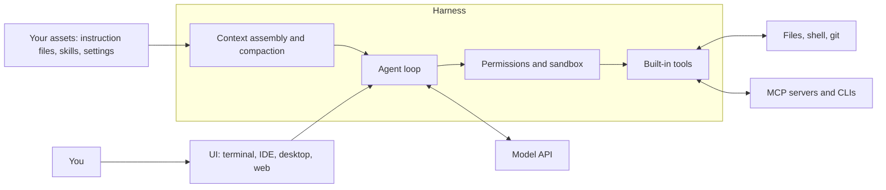

# Harnesses and settings

> A harness is the program that turns a text-generating model into an agent that reads files, runs commands and asks for permission. This chapter explains what a harness does, how the common ones differ, which settings matter, and what to commit versus keep personal. After reading it you can configure one harness deliberately and move to another without rebuilding your setup.

**Read this when:**
- You approve the same harmless command twenty times a day, or you have stopped reading the prompts.
- Your team uses one coding agent but everyone's configuration is different.
- A new harness or model is out and you want to try it without losing a week.
- You are about to let an agent run unattended and need to know what constrains it.

## What a harness is

The model produces text. Everything else is the harness: Claude Code, Codex, Cursor, Pi, OpenCode and others.



A harness does five jobs:

1. **Runs the loop.** Call the model, run the tool it asked for, append the result, repeat until the model answers in plain text. See [The agent loop and primitives](../03-agents/01-agent-loop-and-primitives.md).
2. **Assembles the context.** System prompt, tool definitions, instruction files, memory, the list of skills (instruction files loaded on demand), environment facts, compaction. See [Context engineering](02-context-engineering.md).
3. **Provides tools.** Read, edit, shell, search, subagents, plus what you add through MCP (Model Context Protocol, the standard for connecting external tools) or command-line programs.
4. **Decides what may run.** Permission prompts, rules, sandboxing.
5. **Presents it.** Terminal UI, editor panel, desktop or web app.

People treat all of this, plus their own skills and instruction files, as one product. Separating the parts is the most useful idea in this chapter:

| Part | Who owns it | How portable |
|---|---|---|
| Model | The provider | Swappable, if the harness supports several |
| Harness core (loop, system prompt, built-in tools) | The harness vendor | Not portable; you replace it |
| UI | The harness vendor, or a separate layer on top | Replaceable independently in some setups |
| Settings (permissions, model, sandbox) | You, in the harness's own format | Concepts carry over, files do not |
| Assets (instruction files, skills, MCP servers, CLIs, docs) | You | Largely portable if you keep them in open formats |

Put your effort into the bottom row. It survives every switch.

## How harnesses differ

| Kind | Examples | You get | You give up |
|---|---|---|---|
| Provider-native | [Claude Code](https://claude.com/product/claude-code), [Codex](https://openai.com/codex/) | The pairing the lab tunes and trains its models on | One provider's models |
| Multi-provider and customisable | [Pi](https://pi.dev/), [OpenCode](https://opencode.ai/) | Any major provider, several models on one task, deep customisation through extensions | More of the setup is yours to maintain; a non-native pairing can be less tuned |
| Editor-centred and out of the box | [Cursor](https://cursor.com), [Zed](https://zed.dev/), [Devin](https://devin.ai/) | Much works without configuration; some include cloud agents and orchestration | Less control over internals |
| A layer above harnesses | [Herdr](https://herdr.dev/), [Superset](https://superset.sh/) | Several agent sessions in one place; Herdr keeps them alive when you close the window | One more tool to run |

When choosing:

- **Core features converge.** MCP, skills, subagents and instruction files exist almost everywhere, and a popular new feature is copied within weeks. Switching for one feature is rarely worth it.
- **Some capabilities are worth a switch.** So far: agents that configure themselves and start other instances, and agents that run in the cloud without your machine. Moving quickly when that happens is the reason to keep your assets portable.
- **Models behave best in their lab's harness.** Labs train on traces from their own tool. Leave the native pairing for a reason: several providers, deeper customisation, embedding the harness in your product.
- **Minimal harnesses teach the most.** Pi starts with four tools (read, bash, edit, write) and a short system prompt. Run the self-report prompt from [Context engineering](02-context-engineering.md#ask-the-agent-what-it-sees) in two harnesses and compare what each loads.

You do not have to track every release. Follow your tools' official channels and give anything new about a month.

## The settings that matter

Examples use Claude Code, as of late 2026. Keys and defaults change between versions, so confirm against the documentation under Resources.

### Scope: who a setting applies to

Claude Code reads JSON settings from several files. The file decides the audience.

| Scope | File | Applies to | Commit it? |
|---|---|---|---|
| User | `~/.claude/settings.json` | You, in every project on this machine | No, it is outside the repository |
| Project | `.claude/settings.json` | Everyone who works in the repository | Yes |
| Local | `.claude/settings.local.json` | You, in this repository only | No, keep it git-ignored |
| Managed | Deployed by your organisation | Everyone it is deployed to | Not yours to edit |

When a key is set in several places, the order is: managed, command-line flags, local, project, user. List-valued keys such as permission rules are merged across files, so the project file adds team rules without wiping your own. `/status` shows which files were loaded.

Two details:

- "Yes, and don't ask again" on a permission prompt writes an allow rule into your local file. That file grows quietly. Read it now and then.
- Cloning a project cannot loosen your safety. A committed file cannot start your sessions in the mode that skips all permission checks, and its allow rules apply only after you trust the folder. Deny and ask rules apply immediately.

### Permission modes

The mode decides what happens when the agent wants to do something that is not covered by a rule.

| Mode | Behaviour | Use it for |
|---|---|---|
| `default` (shown as Manual) | Reads run freely; edits and most commands ask | Unfamiliar code, sensitive work |
| `acceptEdits` | File edits and common file commands in the working directory run without asking | Iterating on code you review in a diff anyway |
| `plan` | Explores and proposes, does not edit source files | Understanding before changing |
| `auto` | Runs without routine prompts; a classifier model reviews actions before they execute | Long tasks, fewer interruptions |
| `dontAsk` | Anything that would prompt is denied | Locked-down scripts and CI |
| `bypassPermissions` | Skips permission prompts | Disposable containers and VMs only |

`Shift+Tab` cycles modes in the terminal; `permissions.defaultMode` sets the starting one. Recent versions start interactive terminal sessions in `auto`.

Auto mode reduces prompts; it is not a guarantee. It does stop things: the classifier can refuse an outward action, such as a command that would create a public repository, and hand the decision to you. When that happens, approve the single action if you want it. Do not switch the whole session to bypass.

Deny rules hold in every mode, including bypass, so the deny list is the place for anything that must never happen.

### Allow, ask and deny rules

Rules name a tool and, optionally, a pattern. They are checked in a fixed order: deny first, then ask, then allow. The first match wins, and a narrower allow rule cannot carve an exception out of a broader deny or ask rule.

```json
{
  "$schema": "https://json.schemastore.org/claude-code-settings.json",
  "permissions": {
    "allow": [
      "Bash(pnpm lint)",
      "Bash(pnpm test *)",
      "Bash(pnpm build)"
    ],
    "ask": [
      "Bash(git push *)",
      "Bash(gh pr create *)"
    ],
    "deny": [
      "Read(./.env)",
      "Read(./.env.*)",
      "Read(./secrets/**)",
      "Bash(terraform apply *)"
    ]
  }
}
```

Writing them well:

- **Allow what is frequent and harmless**: build, test, lint. Prompt fatigue is a safety problem; people who approve fifty prompts an hour stop reading them.
- **Ask for what leaves your machine**: pushes, pull requests, messages, deploys.
- **Deny what must not happen**: reading secrets, destructive infrastructure commands, production writes.
- **Put the wildcard after the subcommand.** `Bash(git log *)` allows `git log`. `Bash(git *)` allows every git command, including the ones you wanted to be asked about.
- **Do not police arguments with patterns.** A rule meant to restrict `curl` to one host is defeated by a flag, a redirect or a variable. Use the sandbox's network allowlist.

Two limits:

- **Rules are enforced by the harness, not by the model.** An instruction file saying "never push to main" shapes what the agent attempts. A deny or ask rule decides what runs.
- **A `Read` deny rule covers the file tools, not every process.** A script the agent runs can still open the file; operating-system enforcement needs the sandbox. Rules that need logic belong in a hook, a script the harness runs before or after a tool call: see [Hooks, guardrails and security](../02-workspace/05-hooks-guardrails-and-security.md).

`/permissions` lists every active rule and the file it came from.

### Sandboxing

The sandbox is an operating-system boundary around shell commands and the processes they start. Permission rules decide whether a command may start; the sandbox limits what it can touch once it runs.

```json
{
  "sandbox": {
    "enabled": true,
    "allowUnsandboxedCommands": false,
    "filesystem": { "denyRead": ["~/.ssh", "~/.aws"] },
    "network": { "allowedDomains": ["registry.npmjs.org", "github.com"] }
  }
}
```

Before trusting it:

- Writes are limited to the working directory and a temp directory by default. Reads are not: credential files in your home directory stay readable unless you deny them as above.
- Network access goes through an allowlist that starts empty.
- It covers shell commands, not the harness's own file and web tools, MCP servers or hooks.
- A command you exclude from the sandbox runs with your full access.
- It runs on macOS, Linux and WSL2. On native Windows, commands run unsandboxed.

Sandbox plus auto-approval of sandboxed commands is a good default for local work: few prompts, bounded damage. Unattended agents belong on a separate machine or container with their own accounts; see [Autonomous systems](../05-autonomy/01-autonomous-systems.md).

### Model and effort

Set a default model (`model`, or `/model` in a session) and a default effort (`effortLevel`, or `/effort`). Aliases such as `opus`, `sonnet` and `haiku` follow the current model in each tier, so the setting does not go stale.

Choose both at the start of a task: changing the model mid-session discards the prompt cache. Subagent definitions can pin their own model and effort, which is how routine work goes to a cheaper tier. Choosing a tier is covered in [How LLMs work](01-how-llms-work.md#model-tiers-and-picking-one-per-task).

### Plugins

A plugin bundles skills, subagents, hooks and MCP servers into one installable unit, distributed through a marketplace (a catalogue that can be a git repository). It is a convenient way to ship a team's shared [skills](../02-workspace/02-skills.md) and hooks. `/plugin` opens the browser; install scope mirrors settings scope.

- A project-scope install records the plugin under `enabledPlugins` in the committed settings file. Teammates still install it once per clone.
- A plugin can run hooks and MCP servers on your machine. Read what it adds before installing.
- Every enabled plugin adds always-loaded context. `claude plugin details <name>` shows the token cost.

### Status line

The status line is a row at the bottom of the terminal produced by your own script. The harness passes session data as JSON on standard input and prints what the script outputs. Show the model and how full the context window is. Save this as `~/.claude/statusline.sh` (it needs `jq`):

```bash
#!/usr/bin/env bash
input=$(cat)
model=$(echo "$input" | jq -r '.model.display_name')
pct=$(echo "$input" | jq -r '.context_window.used_percentage // 0' | cut -d. -f1)
dir=$(echo "$input" | jq -r '.workspace.current_dir')
branch=$(git -C "$dir" branch --show-current 2>/dev/null)
echo "$model | ctx ${pct}% | $(basename "$dir")${branch:+ ($branch)}"
```

```json
{
  "statusLine": { "type": "command", "command": "~/.claude/statusline.sh" }
}
```

Or describe what you want to `/statusline` and let the harness write the script.

### The same concerns in other harnesses

As of late 2026; check each tool's documentation before copying a key.

| Concern | Claude Code | Codex | Pi |
|---|---|---|---|
| User config | `~/.claude/settings.json` | `~/.codex/config.toml` | Settings in the agent directory |
| Project config | `.claude/settings.json` and `.claude/settings.local.json` | `.codex/config.toml`, loaded only for trusted projects | Settings in the project's `.pi` directory, which override user-level ones |
| Model and effort | `model`, `effortLevel` | `model`, `model_reasoning_effort` | `defaultModel`, `defaultThinkingLevel` |
| Approvals | Permission modes plus allow, ask and deny rules | `approval_policy` (for example `on-request`) | See the Pi docs; extensions can hook into the agent's lifecycle |
| Sandbox | `sandbox` block | `sandbox_mode` (for example `workspace-write`) | See the Pi docs |
| Instruction file | `CLAUDE.md`, or `AGENTS.md` when no `CLAUDE.md` exists | `AGENTS.md` | Project instruction files such as `AGENTS.md` |

Most current harnesses can configure themselves: the agent reads the harness documentation and edits the settings files. "Add an ask rule for anything that pushes or opens a pull request" is a reasonable request. Review the diff, because settings are the one file an agent must not loosen on its own.

## What to commit and what to keep personal

| Commit for the team | Keep personal |
|---|---|
| Project instruction file (`AGENTS.md` or `CLAUDE.md`) and rule files | Personal instruction file in your home directory; `CLAUDE.local.md` in the project |
| `.claude/settings.json`: team allow, ask and deny rules, hooks, enabled plugins | `.claude/settings.local.json`: your own approvals and overrides |
| Project skills and subagent definitions | Personal skills that encode your working style |
| Project MCP configuration (`.mcp.json`), without credentials | Tokens and credentials, in a keychain or secret manager |
| A short note on the expected permission mode and sandbox for this repository | Model, effort, theme, status line, key bindings |

Guidelines:

- **Commit what protects the repository and what removes shared friction.** Deny rules for secrets should not depend on each person remembering them, and if everyone approves `pnpm test` daily, allow it once for everyone.
- **Keep preferences and secrets out.** A committed model choice becomes an argument; a token in an `env` block is a leaked token.
- **Ignore the harness's working directories, in git and in your tools.** Agent worktrees (separate git checkouts) under `.claude/worktrees/` hold copies of your tests. A test runner that discovers them reports stale failures that the main checkout does not have. Exclude that directory from the test runner, the linter and search.
- **Review settings changes like code.** A pull request that widens an allow rule deserves a second reader. Team-wide rollout is in the [AI-first transition playbook](../06-field-guides/01-ai-first-transition-playbook.md).

## Compare or switch without redoing everything

Changing harness should feel like changing a dropdown. It can, if the valuable parts of your setup are not written in one harness's dialect.

**Keep assets in open formats.**

- Make `AGENTS.md` the source for project instructions. Recent versions of Claude Code read it when there is no `CLAUDE.md`; if you need both, have `CLAUDE.md` import it with a single `@AGENTS.md` line. Details in [Instruction files and rules](../02-workspace/01-instruction-files-and-rules.md).
- Keep skills in one neutral folder and point each harness at it with a symlink instead of copying. For example, keep skills in `.agents/skills` and link `.claude/skills` to it.
- Prefer MCP servers and plain command-line tools for integrations. Both work from any harness. See [Tools and MCP](../02-workspace/04-tools-and-mcp.md).

**Keep your personal setup in one repository.** Skills, personal instruction files, MCP server list, notes on how each machine should be configured. Setting up a new machine or harness becomes one request, and agents are good at translating a rule file or skill between formats. More in [Portable agent config](../05-autonomy/02-portable-agent-config.md).

**Compare on work, not on feature lists.**

1. Try the new harness with no configuration first, to learn its defaults.
2. Pick two or three real tasks you have already done and can verify.
3. Run them in both harnesses with the same repository, the same instruction file and, if possible, the same model.
4. Compare outcome, corrections you made, elapsed time and cost. Run each more than once; single runs vary.
5. Then port your skills and settings. What you missed in the first hour is the part of your setup that carries real value.

**Keep customisation shallow.** Custom extensions, patched prompts and elaborate hook chains are expensive to leave behind, and they can hold a newer model back because they were built around an older model's weaknesses. Start with defaults, add configuration when a real problem repeats, and prefer changes that would still make sense in another tool. A clear repository with obvious names helps every harness; a clever plugin helps one.

## Common mistakes

- **Running everything in bypass mode on your own machine.** One injected instruction or one wrong `rm` has your full access. Keep bypass for disposable environments.
- **Approving prompts without reading them.** Allow the safe frequent commands so the remaining prompts mean something.
- **Treating an instruction file as a permission system.** The model usually follows it. The harness always enforces a deny rule.
- **Protections only in your user file.** Secret-file deny rules that are not committed protect nobody else.
- **Switching harness for one feature, or building a deep harness-specific setup.** The feature arrives in yours within weeks, and custom scaffolding must be rebuilt at every switch.

## Adopt this

| ID | Practice | Applies to | Effort | First step |
|---|---|---|---|---|
| HAR-1 | Add deny rules for secret files and destructive commands to the committed project settings | Project, Team | S | Create `.claude/settings.json` with `Read` deny rules for `.env` files and your secrets folder |
| HAR-2 | Allow the frequent safe commands so that remaining permission prompts are worth reading | Project, Workspace | S | List the five commands you approve most often and add the harmless ones to the allow list |
| HAR-3 | Put pushes, pull requests and deploys behind ask rules | Project, Team | S | Add `Bash(git push *)` and your deploy command to the ask list in project settings |
| HAR-4 | Show model and context usage in the status line | Workspace | S | Save the status line script from this chapter and point `statusLine` at it |
| HAR-5 | Use auto mode or the sandbox for local work and keep bypass mode for disposable environments | Workspace, Team | S | Check your default permission mode and change it if it skips all checks on your main machine |
| HAR-6 | Split settings into committed team rules and git-ignored personal overrides | Project, Team | M | Move shared rules from your local file to the project file and confirm the local file is git-ignored |
| HAR-7 | Make AGENTS.md the source for project instructions and keep skills in one neutral folder linked into each harness | Project | M | Point both instruction file names at one source and replace copied skill folders with a symlink |
| HAR-8 | Enable the sandbox with a network allowlist and denied credential paths | Workspace, Project | M | Turn the sandbox on, deny reads of `~/.ssh` and cloud credential folders, and allow your package registry and git host |
| HAR-9 | Evaluate a new harness or model on two or three finished tasks before porting your setup | Workspace, Team | L | Choose the tasks and record outcome, corrections, time and cost for your current setup as a baseline |

## Resources

- [Claude Code settings](https://code.claude.com/docs/en/settings): settings files, scopes and precedence, with links to the full key reference.
- [Claude Code permissions](https://code.claude.com/docs/en/permissions): rule syntax, evaluation order and the limits of pattern matching.
- [Claude Code sandboxing](https://code.claude.com/docs/en/sandboxing): what the sandbox isolates and what it does not cover.
- [Codex](https://github.com/openai/codex): OpenAI's open-source terminal agent; a second native harness to compare against.
- [Pi](https://github.com/earendil-works/pi): a minimal, multi-provider coding agent and toolkit that is easy to read and extend.
- [Herdr](https://github.com/herdrdev/herdr): a runtime that keeps terminal agents alive and lets agents manage their own sessions.
- [AGENTS.md](https://github.com/agentsmd/agents.md): the open format for project instructions that most harnesses read.
