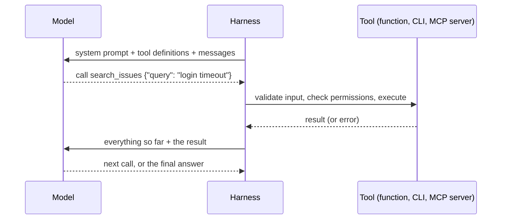

# Tools and MCP

> Tools are how an agent touches anything outside its own text: files, shells, APIs, other people's systems. This chapter explains what happens during a tool call, how to choose between a CLI, an MCP server and a skill with scripts, and how to design and ship a tool an agent uses correctly on the first try. After reading it you can audit the tools your agent has and build a small MCP server you trust.

**Read this when:**
- Your agent has the right tool and still uses it badly, or not at all.
- You are about to connect another MCP server and wonder what it costs.
- You need to expose an internal system to agents and must pick between a CLI, an MCP server and a skill.
- You are building an MCP server and want a checklist before other people connect to it.

## How a tool call works

A model cannot run anything. It can only write text. Tool use is a convention on top of that: the harness (the program that wraps the model, such as Claude Code, Codex, Cursor or Pi) tells the model which tools exist, the model answers with a structured request, and the harness does the work.

**1. The definition.** Every tool is described to the model with a name, a prose description and a JSON Schema for its input. Definitions are part of the context window (the text the model reads on every request), so they cost tokens whether or not the tool is used.

```json
{
  "name": "search_issues",
  "description": "Search the team's issue tracker. Use it before creating an issue, to avoid duplicates. Returns at most `limit` issues, newest first.",
  "input_schema": {
    "type": "object",
    "properties": {
      "query":  { "type": "string", "description": "Words that must appear in the title or body." },
      "status": { "type": "string", "enum": ["open", "closed", "any"], "default": "open" },
      "limit":  { "type": "integer", "minimum": 1, "maximum": 50, "default": 10 }
    },
    "required": ["query"]
  }
}
```

Field names differ a little between providers and protocols (MCP writes `inputSchema`), but the three parts are always there.

**2. The request.** When the model decides a tool would help, it emits a call instead of prose: a tool name plus an input object. It may emit several calls in one turn, and harnesses usually run those in parallel.

**3. The result.** The harness validates the input against the schema, runs the tool and appends the result to the conversation. The model reads it on the next request and decides what to do next.



Four consequences follow, and the rest of the chapter builds on them.

- **The schema constrains the shape, not the values.** A harness can reject a missing field. It cannot know that the issue number the model wrote is invented.
- **Every result becomes context.** A 40 KB reply sits in the window for the rest of the session and steers later behaviour. Many harnesses write oversized results to a file and give the model a path instead.
- **Errors are results too.** A failed tool should return a message the model can act on. Only failures of the system itself (the model API is down) should reach the person.
- **The model decides what to call and how.** That is why tool design is closer to writing documentation than to writing an endpoint.

## Where tools come from

| Kind | What it is | Examples | Context cost |
|---|---|---|---|
| Native | Built into the harness | Claude Code's `Read`, `Edit`, `Bash`, `Grep`, `WebFetch` | Always loaded |
| MCP | Served by a separate process or remote service over the Model Context Protocol | An issue tracker, a browser, a database | Definitions, loaded up front or on demand |
| CLI | Any program the agent runs through its shell tool | `git`, `gh`, `psql`, your own `./scripts/deploy-status` | Nothing until the agent runs it |
| Script in a skill | A file the agent runs after loading a skill (a folder of instructions and helpers, see [Skills](02-skills.md)) | `scripts/attest.sh` inside a `pre-push-review` skill | One description line until the skill loads |

## Discovery: up front or on demand

An agent can only use a tool it knows about. There are two ways to tell it.

**Up front.** Put every definition in the request. The agent can call anything immediately, and you pay for all of it on every turn. One server with 60 tools takes a noticeable share of the window before the first message.

**On demand.** Give the agent a search tool and a short index. Definitions load only when a search matches. The window starts almost empty, and the agent spends an extra step finding the tool.

Claude Code does the second by default for MCP servers (as of late 2026; the feature is called tool search). At session start only tool names and each server's instructions are loaded. Its MCP docs list the switches (`ENABLE_TOOL_SEARCH`, "always load" flags) and the character limits applied to descriptions.

Deferred loading changes what a good description looks like. Search matches against the start of the description, so the words a model would search for belong in the first sentence. Server instructions become the equivalent of a skill description: a few lines saying when this server is worth searching.

A related technique goes further. Instead of reading every intermediate result, the model writes a short program that calls the tools, filters and joins the results in a sandbox, and returns only the answer. You will see it called code mode or programmatic tool calling. It pays off when the model would otherwise read hundreds of records to pick three, and adds nothing to a single lookup. Measure tokens, latency and correctness on your own task before adopting it.

At company scale, discovery becomes infrastructure: a registry and gateway in front of thousands of tools. The Uber engineering post in the resources describes one.

## CLI, MCP server, or skill with scripts

All three give an agent a new capability. They differ in who can use it, how it authenticates and what it costs.

| | CLI tool | MCP server | Skill with scripts |
|---|---|---|---|
| Best for | A local process used by one developer or machine | A capability shared across people, harnesses or products | A team-specific procedure with deterministic helpers |
| Who can use it | Any agent with a shell | Any MCP client, including chat and mobile apps | Harnesses with skills and a filesystem |
| Auth | Whatever the CLI already has on that machine | Per-user OAuth or a token, enforced by the server | Inherits the shell's credentials |
| Input contract | `--help` text and exit codes | JSON Schema, validated before the call | Whatever the instructions say |
| Context cost | None until used | Definitions (small if deferred) | One description line until loaded |
| Operations | A binary to install | A service to host, monitor and version | Files in the repo |

Rules of thumb:

- **Local and single-user: prefer a CLI.** Models already know `git`, `gh`, `curl` and `docker`. A CLI composes with pipes, so the agent can cut a large output down with `jq` or `head` before it reaches the context. For your own script, a good `--help` and clear exit codes are the whole interface.
- **Remote, shared, or per-user identity: build an MCP server.** It is the only one of the three that works from a chat app, gives each user their own login, and lets you change behaviour centrally.
- **"How we do X here": write a skill.** If the hard part is the order of steps and the conventions, the capability is a procedure. Put the repeatable parts in scripts and let the skill say when to run them.
- **Combine them.** A skill that names the tools it relies on, and a tool description that mentions the skill, find each other from either side. MCP also has an extension for serving skills next to a server's tools.

When skills carry the procedures, scope tool access in each skill's frontmatter (the YAML header of the skill file). One reasonable set of choices:

- `allowed-tools` pre-approves tools while the skill runs. Treat it as a grant, not a restriction, keep it narrow, and never pre-approve the destructive step (a push, a cloud write, a post to an external system).
- `disable-model-invocation: true` goes on skills with irreversible or privileged side effects, so those run only when a person types the command.
- A custom `mcp:` list names the MCP servers a skill calls. The harness ignores it. A session-start check reads it and warns when a declared server is not connected (see [Skills](02-skills.md#declare-dependencies-and-check-them-at-session-start)).

The first two are Claude Code keys as of late 2026. Check your harness's skills documentation before copying them.

## Design a tool an agent can use well

Start with whether you need a tool at all. A capable model can call a well-known, well-documented API directly with `curl`. Wrap an API in a tool when:

- **The API lies.** Some services return success when the action did not happen. A wrapper can read the resulting state and report the truth.
- **The API needs a fixed sequence.** If changing a price means "create a new price, then deactivate the old one", encode that once.
- **The API is unknown to the model.** Internal systems are not in the training data.
- **You need control.** Identity, audit, rate limits and redaction belong in code.

Then design for a reader who sees only the definition.

**Name it so the call reads like a sentence.** `search_issues`, `deploy_get`, `note_add`. Harnesses prefix MCP tools with the server name (`mcp__tracker__search_issues` in Claude Code), so pick a server name that is short and unlikely to collide.

**Write the description for a stranger.** Another application may discover the tool with no knowledge of your system prompt. Say what it does, when to use it, whose data it covers and its limits.

**Keep inputs narrow.** Few parameters, enums instead of free strings, defaults for everything optional, explicit maximums. Never accept identity as an argument. Take it from the authenticated session and enforce access in the implementation: a valid order id is not proof that this caller may see the order.

**Size the result for a context window.** Return what the next decision needs. Paginate with a cursor and a small default limit. Render compact text instead of raw JSON, and do not send the same content twice in two formats. A result that carries the full text once as structured data and again as text is nearly twice the size it needs to be, and a client with a small result budget will reject it.

**Do the joins for the agent.** If a useful answer needs three API calls (search, a flag per item, a status), make them in the server and return one enriched result. Filtering, pagination and "fetch details for each record" are the hardest parts of any API for an agent.

**Add hints for the next step.** The model decides what happens next, so tell it what is possible.

**Make errors instructions.** Name the input that failed, say what is wrong and what to do instead. Return them as tool errors (MCP results have an `isError` flag) so the model sees them and can recover.

Before and after, for one search result and one error:

```text
Before
{"items":[{"id":4812,"node_id":"MDU6SXNzdWU0ODEy","title":"Login times out","user":{"id":77,
"login":"sam","avatar_url":"https://…"},"labels":[{"id":9,"name":"bug","color":"d73a4a"}],
"state":"open","locked":false, … 40 more fields … }]}

After
3 of 27 open issues matching "login timeout", newest first:
#4812 Login times out after SSO redirect (bug, assigned: sam, updated 2 days ago)
#4790 Session expires during upload (bug, unassigned, updated 6 days ago)
#4633 Timeout on login page behind proxy (question, assigned: lee, updated 3 weeks ago)
More: call search_issues again with cursor "c_2". Full text: get_issue(number).
```

```text
Before
Error: 400 Bad Request

After
Cannot transcribe https://example.com/login: it is a web page (text/html), not audio.
Give a direct link to an audio file (mp3, m4a, wav, ogg).
```

MCP also lets a tool declare annotations such as read-only, destructive and idempotent. Set them honestly: clients use them to decide when to ask the user. They are hints, not a security guarantee.

## The Model Context Protocol

MCP standardises the connection between an agent and the things it uses, so a capability written once works in every compatible harness. It has three roles: the **host** (the harness or application the person uses), the **client** (a component inside the host that holds the connection to exactly one server) and the **server** (a local process or remote service that exposes capabilities).

| A server can expose | What it is | Can you rely on it? |
|---|---|---|
| Tools | Functions with a schema, as above | Yes, in every client |
| Server instructions | A short text on how to use the server | Often trimmed or ignored; keep them brief |
| Resources | Readable reference data addressed by URI | Varies by client |
| Prompts | Reusable prompt templates, often shown as commands | Varies by client |
| Elicitation | The server asks the client to collect an answer from the user | Some clients, Claude Code and Goose among them |
| Sampling | The server asks the host to run a model call | Rare; do not depend on it |
| Extensions | Interactive UI (MCP Apps), skills served over MCP | A few clients; check first |

Design for tools first. Treat everything else as an enhancement that must degrade gracefully.

**Transports.** A server speaks either stdio (the host starts it as a local child process and talks over standard input and output) or Streamable HTTP (the host sends requests to a URL). An older transport based on server-sent events is deprecated in Claude Code. Use stdio for something that must run on the developer's machine and HTTP for everything shared.

**Auth.** A stdio server inherits the environment of the process that starts it. A remote server should use OAuth. As of the 2026-07-28 revision of the spec, a client:

1. Calls the server without a token and receives `401` with a pointer to the server's protected-resource metadata.
2. Reads that metadata to find the authorisation server and its metadata.
3. Identifies itself through a client ID metadata document (a URL the client publishes) or dynamic client registration.
4. Sends the user to the consent page with PKCE and a `resource` parameter that binds the token to this one server.
5. Exchanges the code for a token and calls the server with it.

For a personal server on a private network, a static bearer token in a header is far less code. It gives you no per-user identity and no revocation.

**Revisions.** The spec is versioned by date. The 2026-07-28 revision moves towards stateless servers, with no session handshake before the first call. Clients update at different speeds, so a public server usually has to answer the previous revision too.

**Connecting a server.** In Claude Code:

```sh
# Remote server
claude mcp add --transport http tracker https://tracker.example.com/mcp

# Local process; everything after -- is the server's own command
claude mcp add --transport stdio files -- npx -y some-mcp-server
```

A project can share servers through a `.mcp.json` file in the repo root:

```json
{
  "mcpServers": {
    "tracker": { "type": "http", "url": "https://tracker.example.com/mcp" }
  }
}
```

Scopes decide who gets the server: local (you, this project), project (everyone who clones the repo, after they approve it) or user (you, every project). Run `/mcp` in a session to sign in to OAuth servers. Other harnesses use the same idea with their own config file.

## Build and ship a custom MCP server

A coding agent can generate a whole server from API documentation in one prompt. It cannot know which ten percent of the API your agents need or what shape makes that ten percent easy. That part is your job. The outline below uses a small example: a deploy-status server that lets agents answer "what is deployed where, and what failed?".

**1. Decide the form.** Agents on several machines and in a chat app will use it, and each person should see only their team's services. That rules out a CLI. If only you needed it on your laptop, a script would be the better answer.

**2. Scope by use case, not by endpoint.** Write five questions an agent should be able to answer and derive the tools from them. Do not mirror the API.

| Tool | Kind | Purpose |
|---|---|---|
| `deploys_search` | read | Recent deploys filtered by service, environment and status. Compact list, cursor, hints. |
| `deploy_get` | read | One deploy with its commit, author, duration and last log lines. |
| `deploy_logs` | read | A slice of logs with `grep` and `tail`, capped. |
| `note_add` | write | Attach a short note to a deploy. The only write. |

Rollback is deliberately missing from version one.

**3. Ship one tool end to end first.** Implement `deploys_search` with auth, deploy it, connect it to a real harness and ask a real question. A lean start makes the shape cheap to change. Once the pattern is right, an agent can add the remaining tools by following it.

**4. Settle auth before features.** Who may connect? What does the consent page say? Where does the server keep its own secrets (the platform's secret store, never the repo)? Identity comes from the token, and every query filters by it.

**5. Shape results and errors** with the rules from the previous section.

**6. Test with a script before you trust it.** A model will work around a broken tool and hide the problem from you. Write a plain script that plays the client, and run it against the local and the deployed server:

```js
// check-server.mjs: run before any agent connects.
// call(name, args) wraps an MCP client's tools/call and returns the raw result.
const cases = [
  ["deploys_search", { status: "failed", limit: 3 }, { maxBytes: 1500 }],
  ["deploy_get",     { id: "does-not-exist" },       { error: /no deploy.*does-not-exist/i }],
  ["deploy_logs",    { id: "d_123", tail: 999999 },  { error: /tail.*at most/i }],
];

let failed = 0;
for (const [name, args, want] of cases) {
  const res = await call(name, args);
  const text = res.content?.[0]?.text ?? "";
  const bytes = Buffer.byteLength(JSON.stringify(res));
  const ok =
    (want.maxBytes ? !res.isError && bytes <= want.maxBytes : true) &&
    (want.error ? res.isError === true && want.error.test(text) : true);
  console.log(ok ? "ok  " : "FAIL", name, JSON.stringify(args), `${bytes} B`);
  if (!ok) failed++;
}
process.exit(failed ? 1 : 0);
```

The script should cover:

- Discovery and auth: no token gives `401` with the metadata pointer; a foreign redirect address and a token for another server are refused.
- Every tool with a good input, a bad input and an absurd input.
- Result size against a budget you choose, and structured output validated against its declared schema.
- Error text: does it name the input and the fix?
- One run through an official SDK client for each spec revision you claim to support. A real client checks details that a hand-written `fetch` call skips.

The MCP project also publishes an inspector and a conformance suite, both linked below.

**7. Deploy where you can read the logs.** A serverless platform is the shortest path; a small server you already run works too. Write down for your agents how to reach the instance, read its logs and redeploy. Publish a short page with the tool list, how sign-in works and what data the server keeps.

**8. Evaluate in real harnesses.** Connect the server to the harnesses your users run and repeat the same tasks after every change to a name, description or result shape. Small wording changes move tool selection more than you expect. [Reliability, observability and evals](../03-agents/04-reliability-observability-evals.md) covers automating this.

Expect the first version to be wrong in instructive ways: an upstream outage with no useful error, an API that returns nonsense without failing, a use case nobody predicted. Each one becomes a test case.

## What connected servers cost

Every connected server spends from three budgets.

- **Tokens before you type.** With up-front loading, each definition is sent on every request. With deferred loading you pay for names and instructions, plus one search step when a tool is needed. In Claude Code, `/context` shows what tools currently occupy.
- **Tokens per result.** Claude Code (as of late 2026) warns when an MCP result passes 10,000 tokens, caps results at 25,000 tokens by default (`MAX_MCP_OUTPUT_TOKENS`), and writes long text results to a file instead of the context. A server that follows the size rules above never gets near those limits.
- **Attention.** Ten servers with overlapping tools (`search` in four of them) make selection worse. Fewer, clearly different tools beat a large menu.

Connect servers at project scope when only one project needs them, and remove the ones you have not used in a month. Changing the tool list mid-session can also invalidate the provider's prompt cache from that point on; see [Context engineering](../01-foundations/02-context-engineering.md).

## Tool results are untrusted input

A tool result enters the context with the same standing as everything else. The model has no reliable way to tell "data I fetched" from "instructions I was given". A web page, an issue comment, a file or an MCP result can carry a sentence addressed to the agent, and the agent may follow it. This is prompt injection, and no current model is immune.

The dangerous pattern needs three ingredients in one session: access to something private, exposure to content someone else wrote, and a tool that can send data out. Read from one tool, leak through another.

- **Connect only servers you trust,** and be extra careful with servers that fetch external content. A third-party server's descriptions and results are both inputs to your model.
- **Separate reading from acting.** Keep outward-facing tools (send, post, publish, pay) behind a confirmation. In Claude Code, `mcp__mailer__*` in the `ask` list does that for a whole server.
- **As a server author, enforce in code.** Check access in the implementation, never in the description. Do not return secrets. Label third-party text with where it came from.
- **Verify effects, not claims.** After an action, read the state back.

The full threat model and the layers that contain it are in [Hooks, guardrails and security](05-hooks-guardrails-and-security.md).

## Common mistakes

- **Mirroring the whole API.** Ninety thin tools cost context and force the agent to do the joins. Pick the use cases and build a handful of shaped tools.
- **Descriptions that restate the name.** `get_order: gets an order` says nothing about when to use it or whose orders it returns.
- **Returning raw upstream JSON.** Most of it is noise the model must carry for the rest of the session. Render compact text and paginate.
- **Errors that end in a status code.** `400 Bad Request` gives the agent nothing to try next. Name the input, the problem and the fix.
- **Taking identity from arguments.** A model can be talked into passing another user's id. Use the authenticated session.
- **Building an MCP server for a local, single-user job.** A script with good `--help` is less to run and costs no context.
- **Trusting a server because an agent used it once.** Models route around broken tools. Run the script.

## Adopt this

| ID | Practice | Applies to | Effort | First step |
|---|---|---|---|---|
| MCP-1 | Audit connected MCP servers and remove or project-scope the ones a project does not use | Workspace, Project | S | Run `/mcp` and `/context` (or your harness's equivalent) and note when you last used each server |
| MCP-2 | Rewrite the description of your most misused tool to say what it does, when to use it, whose data it covers and its limits | Project | S | Find one transcript where the agent picked the wrong tool or arguments and fix that description |
| MCP-3 | Make every tool error name the failing input and the next action, returned as a tool error instead of an exception | Project | S | Grep your tool code for generic error strings and rewrite the three most common |
| MCP-4 | Cap and shape tool results: default limit, cursor, compact text, no duplicated payload | Project | M | Measure the byte size of each tool's typical result and set a budget for the largest |
| MCP-5 | Put outward-facing MCP tools behind an ask rule and leave read tools free | Workspace, Team | S | Add each server's send, post and publish tools to the ask list in your settings |
| MCP-6 | Choose the form on purpose: CLI for local single-user jobs, MCP for shared or per-user access, skill for procedures | Team | S | For the next integration request, write one line on who will use it and from where before choosing |
| MCP-7 | Add a client script that tests discovery, auth, each tool with good and bad input, result size and error text, and run it on every deploy | Project | M | Write three cases for one tool, starting from the script in this chapter |
| MCP-8 | Keep tool grants in skills narrow and never pre-approve the destructive step | Project, Team | M | Open your most used skill and list which tools it really needs pre-approved |
| MCP-9 | Build one small MCP server for a system your agents ask about weekly, starting with a single read tool shipped end to end | Team | L | Write five questions agents should be able to answer and derive at most four tools from them |

## Resources

- [Model Context Protocol documentation](https://modelcontextprotocol.io/docs/2026-07-28/getting-started/intro): the spec and concepts for the 2026-07-28 revision; start here before writing a server.
- [MCP SDKs](https://modelcontextprotocol.io/docs/2026-07-28/sdk): official client and server libraries; use one instead of hand-rolling the transport.
- [Stateless MCP proposal](https://modelcontextprotocol.io/seps/2575-stateless-mcp): why newer revisions drop the session handshake.
- [Skills extension for MCP](https://modelcontextprotocol.io/seps/2640-skills-extension): how a server can ship skills next to its tools.
- [MCP Inspector](https://github.com/modelcontextprotocol/inspector): a testing tool for poking at a server by hand.
- [MCP conformance tests](https://github.com/modelcontextprotocol/conformance): automated checks that a server follows the protocol.
- [Claude Code: connect to tools via MCP](https://code.claude.com/docs/en/mcp): adding servers, scopes, OAuth, tool search, output limits.
- [Designing an MCP gateway (Uber Engineering)](https://www.uber.com/blog/designing-mcp-gateway/): tool discovery and authorisation at thousands of tools.
