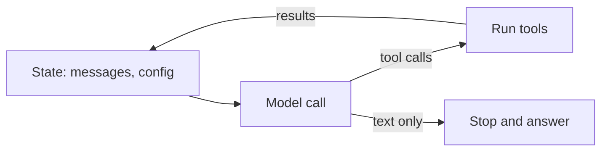

# The agent loop and its primitives

> An agent is a model that calls tools in a loop until something tells it to stop. This chapter opens that loop, names the parts every agent has, and shows how to decide when a task is finished and how to read an old session to recover a decision. After reading it you can predict why your harness behaves the way it does, and change your habits to match.

**Read this when:**
- Your coding agent stops too early, wanders, or "forgets" something you told it an hour ago.
- You are about to build an agent, or customise a harness, and want the mental model first.
- You need to find out what was decided in a session last week, and the chat window is gone.

## An agent is a loop

Strip away the product and every agent is the same few lines. The harness (the program around the model: Claude Code, Codex, Cursor, Pi and so on) sends the conversation and a list of tool descriptions to the model. The model answers with text, or asks to run tools. The harness runs them, appends the results, and calls the model again.

```js
async function runAgent({ system, task, tools, model, maxSteps = 20 }) {
  const messages = [
    { role: "system", content: system },
    { role: "user", content: task },
  ];
  for (let step = 0; step < maxSteps; step++) {
    const reply = await model.complete(messages, tools.schemas); // one model call = one step
    messages.push(reply.asMessage);
    if (reply.toolCalls.length === 0) return reply.text;         // stop: no tool requested
    for (const call of reply.toolCalls) {
      const result = await tools.run(call.name, call.args)
        .catch((err) => `error: ${err.message}`);                // errors go back to the model
      messages.push({ role: "tool", toolCallId: call.id, content: result });
    }
  }
  return "Stopped: step limit reached.";                         // stop: budget exhausted
}
```



Three details in this sketch matter later:

- **The model is stateless.** Everything it knows about your task is in `messages`, resent in full on every call.
- **A step is a model call, not a tool call.** One step can request several tools. A limit of 20 steps is not a limit of 20 actions.
- **The default stop condition is the model's own opinion.** The loop ends when the model answers without asking for a tool. Nothing checks that the work is correct.

For a production-grade version of the same idea, read the agent loop in [Pi](https://github.com/earendil-works/pi/blob/main/packages/agent/src/agent-loop.ts) or [Goose](https://github.com/aaif-goose/goose). Both are open source.

## What the harness adds around the loop

The loop is twenty lines. A harness is far larger, because the bare loop breaks on the first API error. The rest is machinery that makes it survive real work.

| Responsibility | What the harness does | Where you notice it |
|---|---|---|
| Provider connection | Adapters per model provider, retries, fallbacks | A run survives a 503 instead of dying mid-task |
| Sessions | Records every message and tool result to disk | You can resume, fork, or read an old session |
| Context assembly | Builds the prompt, keeps a stable cached prefix, compacts old history | Long sessions keep working, but lose detail |
| Tool execution | Runs tools, enforces permissions, asks you for approval | Permission prompts; a blocked `rm -rf` |
| Hooks | Runs your scripts at fixed moments (before a tool, when the agent stops) | Formatters, guards, done-checks |
| Limits | Step caps, timeouts, token budgets | "Stopped after N turns" |

When your agent fails, the cause is almost always in one of these rows, not in the loop.

## The four primitives

Every agent, from a ten-line script to a full harness, has the same four parts: the loop above, an identity, context and memory, and tools. That gives you four places to look when behaviour is wrong.

### Identity and awareness of the environment

The system prompt tells the model who it is and where it is. Harnesses ship a long one so that you can type short messages. The moment you run an agent without a human in the session (a cron job, a webhook handler, a background worker), you become the author of that prompt, and five blocks need an answer:

| Block | Question it answers | Example line |
|---|---|---|
| Role | Who am I and who do I work for? | "You triage incoming bug reports for the platform team." |
| Environment | Is a human watching? How do I reach one? | "Nobody reads your output live. To reach a person, call `notify`." |
| Map | What resources exist and where? | "Runbooks are in `docs/runbooks/`. One file per service." |
| Discovery | How do I find capabilities I was not told about? | "List `skills/` before you write a new script." |
| Boundaries | What must I not do? | "Never close an issue. Label it and stop." |

Two warnings. Boundaries in a prompt are advice: the model usually follows them, and nothing forces it to. Anything that must hold goes into code (see [Hooks, guardrails and security](../02-workspace/05-hooks-guardrails-and-security.md)). And more text is not better. Start with a few lines, run real tasks, and add an instruction only when a failure shows it is missing. Instruction files for coding harnesses are covered in [Instruction files and rules](../02-workspace/01-instruction-files-and-rules.md).

### Context and memory

Context is what the model sees on this call: system prompt, tool descriptions, message history, tool results. It is finite, and you pay for all of it on every step. Harnesses keep the start of the prompt byte-stable so the provider can cache it, load detail on demand, and compact (summarise) old history when the window fills. Compaction is lossy: a decision made early in a long session can shrink to half a sentence, or vanish. The mechanics are in [Context engineering](../01-foundations/02-context-engineering.md).

Memory is anything that survives the session. It has four jobs: extracting facts worth keeping, storing them, retrieving the right ones later, and presenting them to the model. The hard parts are deciding what is worth remembering and resolving a new fact that contradicts an old one. A reliable start is boring: the agent saves a fact only through an explicit tool call, into a named category, scoped to one user or project. Automatic "remember everything" memory carries yesterday's order number into today's unrelated request. See [Knowledge and memory](../02-workspace/03-knowledge-and-memory.md).

### Tools

A tool has three parts with three different jobs:

- **Description**: tells the model what the tool does and when to use it.
- **Schema**: lets your code validate the shape of the request.
- **Implementation**: decides what really happens.

Enforce rules in the implementation. If a lookup tool takes an order id, the query must also filter by the current user's id taken from the session, not from the model. A valid-looking argument is not an authorised one.

A model uses tools in two ways. With function calling, every result lands in the context. With code mode, the model writes a script that chains several tools and returns only the final value; large outputs go to a file and the model gets the path. That is why a coding agent with a shell and a filesystem can do far more than its tool list suggests. Tool design and MCP are in [Tools and MCP](../02-workspace/04-tools-and-mcp.md).

## Stop conditions and done-checks

A run can end for several reasons, and only one of them means success.

| Stop condition | Decided by | Means |
|---|---|---|
| Model returns text with no tool call | The model | "I believe I am finished", or "I have a question" |
| Step, token or time limit reached | The harness | Out of budget, state unknown |
| Waiting for approval | The harness | Paused, may resume in a minute or in three days |
| Done-check passes | A command | The condition you defined holds |

The first row is the default, and it is the weak one: confidence is not correctness. A **done-check** replaces opinion with a command whose exit code says whether the task is finished. Tests pass. The endpoint returns 200. A source the work depends on has not changed since the agent last read it.

In Claude Code the natural place is a `Stop` hook, a script the harness runs when the agent tries to end its turn. Exit code 2 sends the script's stderr back to the agent and keeps it working.

```json
{
  "hooks": {
    "Stop": [
      { "hooks": [ { "type": "command", "command": "\"$CLAUDE_PROJECT_DIR/.claude/hooks/done-check.sh\"", "timeout": 300 } ] }
    ]
  }
}
```

```sh
#!/bin/sh
# .claude/hooks/done-check.sh (needs jq). The agent may stop only when the check passes.
session=$(jq -r '.session_id')                    # hook input arrives as JSON on stdin
rounds_file="${TMPDIR:-/tmp}/done-check-$session"
rounds=$(cat "$rounds_file" 2>/dev/null || echo 0)

if output=$(npm test 2>&1); then rm -f "$rounds_file"; exit 0; fi  # done: let it stop
if [ "$rounds" -ge 3 ]; then rm -f "$rounds_file"; exit 0; fi       # give up: a human looks

echo $((rounds + 1)) > "$rounds_file"
echo "Done-check failed (round $((rounds + 1)) of 3). Fix the cause before you stop:" >&2
echo "$output" | tail -n 30 >&2
exit 2
```

Always cap the rounds: a check that can never pass becomes an infinite loop that spends money. The hook input also carries a `stop_hook_active` flag, set when the agent is already continuing because of a stop hook; use it if you want a single retry instead of a counter. Hook keys and exit codes are version-sensitive (this is the behaviour as of late 2026); confirm in the [hooks reference](https://code.claude.com/docs/en/hooks).

If your harness has no stop hook, wrap it. The loop moves outside the agent:

```sh
for attempt in 1 2 3; do
  ./done-check.sh && break
  claude -p "Run ./done-check.sh, read why it fails and fix the cause. Do not edit done-check.sh."
done
```

Two rules keep a done-check honest. The agent must not be able to edit it (protect the file with a permission rule). And it must test the outcome, not a proxy the agent can satisfy cheaply. See [Verification and quality gates](../04-delivery/03-verification-and-quality-gates.md).

## Sessions on disk, and how to recall a decision

A session is a file. Most harnesses write one JSON object per line (JSONL) as the conversation happens: your prompts, the model's text, each tool call, each result, and compaction summaries.

- **Claude Code**: `~/.claude/projects/<project>/<session-id>.jsonl`, where `<project>` is the working directory's path with separators and dots replaced by dashes. Subagent transcripts sit beside it in `<session-id>/subagents/agent-<id>.jsonl`. Old transcripts are deleted after a retention period (the `cleanupPeriodDays` setting, 30 days by default as of late 2026).
- **Codex CLI**: also one JSONL file per session, under its home directory (`~/.codex/` by default). The line format differs from Claude Code's; check your version for the exact folder.
- **Other harnesses**: look for a sessions folder in the config directory. Not every harness exposes one.

These formats are not stable interfaces, so treat any parser as disposable. This one flattens a Claude Code session into one readable line per event:

```python
#!/usr/bin/env python3
"""Flatten a Claude Code session file: one line per event, with timestamps."""
import json, sys

def clip(value, limit=300):
    text = value if isinstance(value, str) else json.dumps(value, ensure_ascii=False)
    return text if len(text) <= limit else text[:limit] + " ..."

for raw in open(sys.argv[1], encoding="utf-8"):
    if not raw.strip():
        continue
    event = json.loads(raw)
    when, who = event.get("timestamp", ""), event.get("type")
    content = (event.get("message") or {}).get("content")
    if isinstance(content, str):
        print(f"[{when}] {who}: {clip(content, 2000)}")
    for block in content if isinstance(content, list) else []:
        kind = block.get("type")
        if kind == "text":
            print(f"[{when}] {who}: {clip(block['text'], 2000)}")
        elif kind == "tool_use":
            print(f"[{when}] call {block.get('name')}: {clip(block.get('input'))}")
        elif kind == "tool_result":
            print(f"[{when}] result: {clip(block.get('content'))}")
```

### A recall procedure

The question is usually "what did we decide about X, and is that still the decision?" Answering it from one session is how you get it wrong.

1. **Find candidates.** `grep -l` the keyword across every session folder that could hold the topic: the project's folder, any other checkout of the same repository, a server, CI.
2. **Flatten and read around each hit.** Look for a proposal followed by an approval ("go with that", "do it"). A proposal nobody approved is not a decision.
3. **Order by timestamp, in one time zone.** The latest approved decision wins.
4. **Check subagent transcripts.** A subagent may have found the reason for a change that the parent session only summarised.
5. **Distrust compaction summaries.** If a summary and the original messages disagree, the original messages are right.
6. **Write the result down with its source**: the choice, the session id and the time. Then it never needs recalling again.

An example shows why each step is there. Suppose an agent is asked to write the storage plan for a small upload service from "what we decided last week". The first session it finds holds a clear proposal (local disk, a metadata table, one library) and a clear approval. A plan built from that session alone can still be wrong in several ways:

- A compaction summary later in the same session keeps the storage choice and drops the library.
- A later session, started from another checkout, hits a concurrency failure and moves to object storage. The approval is two words long and easy to miss.
- A session run for CI changes the bucket naming and pins a version. The reason is only in its subagent's transcript.

The later sessions do not live in the first one's folder. A correct plan cites every session it draws on, each row with a session id and a timestamp.

The durable fix is upstream: write decisions into a repository file when they are made, so recall is a `cat` and not an investigation. Session files also contain everything you pasted, secrets included, so never commit them or pass them on unscrubbed.

## How this changes the way you use a harness

Each mechanic of the loop implies a habit, even if you never build an agent.

| Mechanic | Habit |
|---|---|
| The whole context is resent on every step | Keep `AGENTS.md` / `CLAUDE.md` short. Long files cost money and attention on every call. |
| The cached prefix must stay identical | Do not edit instruction files or switch tool sets mid-session without a reason. |
| Compaction is lossy | Put decisions and plans in files. Re-invoke a skill after compaction if its rules stopped being followed. |
| The model discovers resources on demand | Give it a map: where things are, how to find more. Do not paste the things themselves. |
| Prompt boundaries are advice | Put real limits in permissions and hooks. |
| The model stops when it feels done | Give every non-trivial task a done-check. |
| Long threads drift | One task per session. Start fresh, or delegate, when the topic changes (see [Subagents and multi-agent work](03-subagents-and-multi-agent.md)). |
| Tool results fill the window | Prefer commands with short, relevant output. Send big output to a file. |

To make this stick, build the twenty-line loop once with two tools. [Build your own agent](02-build-your-own-agent.md) walks through a complete one.

## Common mistakes

- **Treating "the agent said it is done" as done.** The loop ends on the model's opinion. Attach a command that decides, and cap how often it can push back.
- **Putting hard rules only in the prompt.** The model can ignore them, and an injected instruction can override them. Enforce in the tool implementation, in permissions or in a hook.
- **Trusting one session as the record.** Decisions get revised in other sessions, other checkouts and subagent transcripts. Order all of them by time before you conclude anything.
- **Believing a compaction summary over the messages it replaced.** Summaries drop detail silently. Go back to the raw lines.
- **Counting on session files as an archive.** They are cleaned up on a schedule and their format changes. Decisions belong in the repository.
- **Writing a long system prompt first.** Start with role, environment and one boundary. Add lines only for failures you observed.

## Adopt this

| ID | Practice | Applies to | Effort | First step |
|---|---|---|---|---|
| AGT-1 | Give each non-trivial agent task a done-check command and state in the prompt that the task ends only when it passes | Project, Workspace | S | Pick the one command that proves your current task is finished and paste it into the prompt |
| AGT-2 | Record each approved decision in a repository file with its source | Project, Team | S | Create `docs/decisions.md` with columns Area, Choice, Source and add the last decision you approved |
| AGT-3 | Run one task per session and start a fresh one when the topic changes | Workspace | S | At the next "while we are here", open a new session and paste only the context it needs |
| AGT-4 | Move every "never do X" that must hold from the instruction file into a permission rule or hook | Project | M | List the "never" lines in your instruction file and mark which are enforced by more than text |
| AGT-5 | Install a Stop hook that blocks the stop while the done-check fails, capped at three rounds | Project | M | Copy the `done-check.sh` sketch above, replace `npm test` with your command and register it under `hooks.Stop` |
| AGT-6 | Keep a session-flattening script and follow the recall procedure when asked "what did we decide about X" | Workspace | M | Save the Python sketch above as `tools/flatten-session.py` and run it on your latest session file |
| AGT-7 | Write the five prompt blocks (role, environment, map, discovery, boundaries) for every agent that runs without a human | Project | M | Open the prompt of one scheduled agent you own and note which block is missing |
| AGT-8 | Build a minimal loop with two tools once, to learn where harness behaviour comes from | Workspace | M | Have your coding agent implement the loop above on your provider's official SDK with `read_file` and `list_dir` tools |

## Resources

- [Pi agent loop source](https://github.com/earendil-works/pi/blob/main/packages/agent/src/agent-loop.ts): a complete, readable loop that many other projects build on.
- [Goose](https://github.com/aaif-goose/goose): another open-source harness; useful to compare how a second team solved the same problems.
- [Claude Code hooks reference](https://code.claude.com/docs/en/hooks): the events, input fields and exit-code rules behind the Stop-hook done-check.
- [Claude Code subagents](https://code.claude.com/docs/en/sub-agents): includes where session and subagent transcripts are stored and when they are cleaned up.
- [Building effective agents](https://www.anthropic.com/engineering/building-effective-agents): a short, vendor-written overview of when a loop is the right tool and when a fixed workflow is better.
