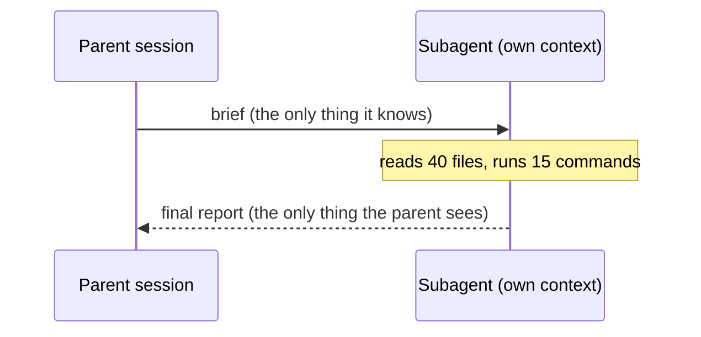

# Subagents and multi-agent work

> A subagent is a second agent your agent starts, with its own context, to do one piece of work and report back. This chapter explains the mechanics, what delegation costs, how to brief a subagent, how to run parallel workers in isolated git worktrees, and which multi-agent shapes are worth building. After reading it you can decide when to split work across agents and when one agent is the better design.

**Read this when:**
- Your main session fills up with file dumps and search results, and loses the thread.
- You want several issues worked in parallel without the agents overwriting each other.
- Someone proposes "a team of agents" and you need to judge whether it beats one agent with a good prompt.

## What a subagent is

To the model, a subagent is a tool. The parent calls it with a prompt, the harness runs a separate agent loop, and one message comes back as the tool result.



Everything else follows from the two arrows. The subagent knows only what the brief says. The parent sees only the report: not the files read, not the dead ends, not the doubts.

### Fresh context or fork

| | Fresh subagent | Fork |
|---|---|---|
| Starts with | Its own system prompt and your brief | The parent's whole conversation so far |
| Model and tools | Set per agent type or per call | The parent's |
| Good for | Independent, well-specified work; a second opinion not anchored on yours | Work that needs the background and would take a page to brief |
| Main risk | A thin brief gives a confident answer to the wrong question | It inherits open plans and may carry on with the parent's job |

In Claude Code a fork returns only its final result to the parent, like any subagent (`/subtask <task>` starts one by hand, as of late 2026). You can also branch a whole session to explore a tangent without polluting the original: `claude --resume <id> --fork-session`, or `codex fork` in Codex.

End a hand-made branch with a notice. The copy has inherited a transcript full of unfinished plans and will try to finish them:

```text
This conversation was branched from one that is still running. Do not continue any earlier work.
Expect files to change underneath you. Act only on what I ask next.
```

### Settings and templates

A subagent can run with a different model, reasoning effort, tool list and permission mode from its parent. Reusable definitions are text files. In Claude Code they live in `.claude/agents/` (project) or `~/.claude/agents/` (personal):

```markdown
---
name: migration-checker
description: Checks a database migration for data loss and lock risk. Use before merging any migration file.
tools: Read, Grep, Glob, Bash
model: sonnet
---
You review exactly one migration file, given by path.
Report: (1) statements that can lose data, (2) statements that take long locks, (3) whether a down-migration exists.
Quote the line for every finding. If you find nothing, say so in one line. Do not edit files.
```

Codex and Pi support the same idea natively or through extensions. Frontmatter keys change between versions, so confirm against the [subagents reference](https://code.claude.com/docs/en/sub-agents).

A **worker** is a subagent in its own process: a second harness session in another terminal pane, on a server or in CI, started by an agent, a script, a schedule or a webhook. It reports through files or a message when it finishes.

## When delegation pays, and what it costs

Delegation is not free parallelism. It has four costs.

- **Detail is lost twice.** Once when you compress what you know into a brief, and again when the subagent compresses what it found into a report. Neither side can tell what the other missed.
- **Tokens.** Every subagent rebuilds its context by reading, so each one can cost as much as a full session. A review skill that starts several subagents on every run multiplies that. The skill's text can be short; the cost is the fan-out it mandates. Measure a run before you make fan-out a default.
- **Confident wrong answers.** Mistakes come back in the same tone as findings. A subagent handed your hypothesis tends to return it confirmed.
- **No steering.** You cannot watch it think. You wait or you cancel.

| Delegate when | Do it in the main session when |
|---|---|
| The work is independent and can run in parallel | Steps depend on each other's results |
| It means reading widely and you only need the conclusion | It is a handful of tool calls or a lookup you can aim |
| You want a review not anchored on your reasoning | The task needs the conversation so far |
| It needs a different model, tool set or permission level | Several agents would edit the same files |
| File changes should stay isolated until checked | You cannot write a clear brief yet |

The last row is a test: if you cannot write the brief, you do not understand the task well enough to hand it off.

## How to brief a subagent

The brief is the only context a fresh subagent has. Write it for a capable colleague who has never seen the repository.

```text
Goal: find why `orders export` times out for tenants with more than 50k rows.
Already ruled out: the database query (runs in 300 ms, see scripts/explain-export.sql).
Read: src/export/stream.ts, src/export/csv.ts, test/export/large.test.ts
Scope: diagnosis only. Do not edit files. Do not start other subagents.
Return: the most likely cause with file and line, the evidence, and what you did not check.
```

| Part | Why it is there |
|---|---|
| Goal, stated as an outcome | Otherwise it optimises for looking busy |
| What is already known or ruled out | Stops it from re-deriving your last hour |
| Paths to read, not pasted content | The brief stays short and the subagent reads the current file |
| Scope and prohibitions | No commits, no fan-out, no edits outside a folder |
| Shape of the report | You get evidence and gaps, not a narrative |

For an independent read, give it the code and not your conclusion.

**Treat the report as a claim.** Delegated tests are a good place to write this into an implementation skill. A workable rule: the author of a change writes the business-rule tests personally, and the mechanical tests (validator tables, mapper round-trips, an integration test that mirrors its neighbour) go to exactly one subagent. Its brief holds only the paths of the files under test and the sibling test to mirror, the path of the testing rules, the list of cases with the expected value for each, and an instruction to flip each condition once, watch the test fail, restore it and re-run. No other work, no other subagents, no commits. The author then reads every returned test and checks that each case asserts the listed value, not whatever the code happened to produce. A subagent asked to "add tests" will write tests that pass.

## Skills versus subagents

Both are text files that the model sees as a name and a description, so they are easy to confuse.

| | Skill | Subagent |
|---|---|---|
| Runs in | The current thread | A separate thread |
| Sees | Everything in the conversation | Only its brief (or a fork of the conversation) |
| Leaves behind | Its instructions and all its work in your context | One report |
| Use when | The task needs the current context, or you want to stay in the loop | The task is self-contained and its intermediate work is noise to you |

In Claude Code a skill can declare `context: fork` to run in an isolated subagent. That suits long read-only work and is wrong for anything interactive, because an isolated run cannot stop to ask you a question. Do not write skills that fan out to many subagents by default: a skill should do its job in one pass. See [Skills](../02-workspace/02-skills.md).

## Parallel workers in isolated worktrees

Two agents editing one checkout will overwrite each other. A git worktree (a second working directory on its own branch, backed by the same repository) gives each worker a private copy.

```sh
git worktree add ../wt/issue-3 -b issue-3     # one directory and branch per worker
# ... the worker runs there and commits ...
git merge issue-3                             # the parent integrates
git worktree remove ../wt/issue-3
```

In Claude Code, `isolation: worktree` on a subagent does this automatically and removes the worktree if nothing changed. By default the worktree branches from the repository's default branch, not from the parent's uncommitted state, so anything the workers depend on must be committed there first.

### A workable sequence

Take a plan for one new page in a small service, split into issues, with the split reviewed by a person before any code is written.

1. **Build the shared contract first, alone.** The parent does the issue that every other issue depends on (the shared type, the function signature) and commits it before starting any worker. Types and signatures that other issues depend on are not parallel work.
2. **One issue, one worker, one branch.** The remaining independent issues run in parallel, each in its own worktree. The issue is the brief, so it needs a "done when" line. Choose the model per issue, for example:

   | Issue | Kind of work | Model tier, effort |
   |---|---|---|
   | Parse an input file, including a truncated line | Logic with edge cases | Strongest, medium |
   | Render the page | View | Mid, low |
   | JSON endpoint | Thin route | Mid, low |
   | Link from an existing page | Small view change | Smallest, low |
   | Tests for the above | Mirrors existing tests | Smallest, low |

3. **The parent merges, and expects conflicts in registry files** (routes, exports, dependency manifests). Two workers that each add a route will both touch the shared routing file and often add the same import. These conflicts are cheap for the parent to resolve.
4. **Remove the worktrees before the final test run.** A test runner can discover stale copies of test files inside a leftover worktree directory and report failures that are not real. Keep worktrees out of the paths your tools scan, or exclude their directory from the test runner and linter.
5. **Have every worker leave the same closing note**: what changed; harness, model and effort; commit. Later cost and quality comparisons depend on it.

### Workers on other machines

A worker can run anywhere a harness runs: a tmux session on a server, a cloud sandbox, a CI job. Give each worker only its own tools and credentials (a per-worker MCP configuration and an explicit allowed-tools list), and have it write a log of its calls and a result file, because the parent cannot see its screen.

**The parent owns the join.** Two workers can each return a correct result that cannot be combined as it stands: one stamps its records in one time zone, the other in a different one, and a join on the clock digits matches the wrong rows. Whoever merges must normalise units, time zones and identifiers first. No worker can, since each sees only its half.

## Multi-agent architectures

| Shape | How it works | Fits | Main failure |
|---|---|---|---|
| Orchestrator and workers | A lead splits the task, starts workers, merges results | Parallel independent subtasks | The lead's brief or merge is the weak point |
| Pipeline | Fixed stages, each agent hands a defined artefact to the next | Repeatable processes with clear stages | An early error flows through every later stage |
| Peer review | One agent produces, another with fresh context (ideally a different model) reviews | Code, plans, anything with a checkable standard | The reviewer is given the author's reasoning and agrees with it |
| Debate or parallel perspectives | Several agents attack one question from different angles, then compare | Open research and design questions | N times the cost for an answer one good agent would reach |

Looser shapes exist: role agents sharing a workspace with no lead, and swarms where agents decide among themselves who acts. Both remain rare in production as of late 2026.

Whatever the shape, the same engineering is needed:

- **Contracts.** Fixed formats for messages, folders, reports and logs, so code can validate and look things up without a model.
- **Permissions in code.** An agent's scope is its tool list and credentials, not its prompt.
- **One writer per resource.** Give shared files an owner or a queue. Even one agent on two schedules is a multi-agent system: a morning summary that starts before an earlier research run has finished writing its files summarises yesterday.
- **A trace that spans agents**, so a request can be followed across handoffs (see [Reliability, observability and evals](04-reliability-observability-evals.md)).
- **A heartbeat.** From outside, a stuck agent and a waiting one look the same. Have each write a timestamp periodically and alert when it goes stale.

Running a standing team of role agents is its own topic: [Orchestrating agent teams](../05-autonomy/03-orchestrating-agent-teams.md).

## Agent-to-agent protocols

Inside one harness, a subagent call is the protocol. Between your own processes, a queue, a file or an HTTP call is enough. A dedicated protocol becomes useful when the other agent is not yours: another team's, another company's, or a personal agent that must answer requests without exposing what is behind it.

[A2A](https://github.com/a2aproject/A2A) (Agent2Agent) is the open protocol for that case. Its building blocks:

- **Agent card.** A JSON document at a well-known URL (`/.well-known/agent-card.json`) with the agent's name, description, version, endpoint and the skills it offers. Internal tools, memory and prompts are not in it.
- **Messages over HTTP**, usually JSON-RPC, with parts that can be text, structured data or file references. Agents do not share threads, so a message must carry everything the other side needs.
- **Tasks with state.** The server assigns a task id. A task can pause in an input-required state, and the client continues it by sending the answer with the same id.
- **Delivery by polling, streaming or push**, depending on how long the work takes.

MCP and A2A do not compete. MCP gives one agent more tools, and your agent controls every step. A2A hands a whole goal to another agent that keeps its tools and reasoning private. If a supplier offers both an inventory MCP server and a sourcing agent, use the server when you want to drive the search, and the agent when you want to state goal and constraints and get offers back.

Two rules for any agent you do not control: validate what comes back in code before you act on it or show it to a user, and when you relay a person's answer, forward their words, not your model's paraphrase.

A2A is younger and less widely adopted than MCP as of late 2026. Its ideas (published capabilities, server-issued task ids, an explicit "needs input" state) are worth borrowing even if you never speak the protocol.

## Model choice per role

Not every agent needs your best model.

| Role | Start with | Move up when |
|---|---|---|
| Orchestrator, planner, final merge | Strongest tier | (already there) |
| Implementation with real logic | Strongest or mid tier, medium effort | Tests keep failing on edge cases |
| Views, glue, mirrored tests | Smallest or mid tier, low effort | Output needs rework more than once |
| Search and summarise, sidecars | Smallest tier | Reports miss things you later find yourself |
| Judgement on fuzzy criteria | Mid or strongest tier | A cheaper model measurably disagrees with you |
| Reviewer | A different model from the author's, if you can | (independence matters more than tier) |

Start small, test, then move up. Measure cost per completed task, not per call: a cheap model that needs three attempts and a human fix is the expensive option.

## When a single agent is the better design

Prefer one agent when:

- The task fits in one context window with room to spare.
- The steps are sequential and each depends on the last.
- The work touches the same few files.
- You would spend longer writing briefs and merging than doing the work.
- The agents would run on one machine or under one rate limit, where parallel agents starve each other.
- You cannot yet say how you would verify each part.

Much multi-agent structure exists to work around limits of context size and instruction-following. Before investing in an elaborate setup, ask what happens to it when the next model or harness release removes that limit. Splitting for parallelism, isolation and independent review keeps its value. Splitting only to fit the window does not.

## Common mistakes

- **A one-line brief.** The subagent fills the gaps with assumptions and reports with confidence. State the goal, what is ruled out, the paths, the scope and the report shape.
- **Handing over your conclusion with the task.** You get your hypothesis back, confirmed. For an independent read, give the code and the question.
- **Accepting the report without reading the work.** Check returned tests against the expected values you wrote, and rerun the commands that matter.
- **Parallel agents in one checkout.** They overwrite each other. One worktree per worker.
- **Skills that mandate fan-out.** Several subagents by default turn a routine command into a run that costs many times a single pass.
- **Building a team before one agent works.** Get a single agent reliable on the task first, then split what demonstrably benefits.

## Adopt this

| ID | Practice | Applies to | Effort | First step |
|---|---|---|---|---|
| MUL-1 | Use a five-part brief (goal, ruled out, paths, scope, report shape) for every subagent you start by hand | Workspace | S | Save the brief from this chapter as a snippet and use it for your next delegation |
| MUL-2 | Read delegated work before accepting it, checking outputs against expected values you wrote beforehand | Workspace, Team | S | Next time a subagent writes tests, list the expected value per case first and compare |
| MUL-3 | End every hand-forked session with a notice that it is a branch and must not continue earlier work | Workspace | S | Add the three-line notice to a snippet or to your fork command |
| MUL-4 | Add a rule that skills run single-pass and never fan out to several subagents by default | Project, Team | S | Search your skills for "subagent" and "in parallel" and count how many agents each can spawn |
| MUL-5 | Define project subagents as files with a narrow tool list and an explicit model for recurring read-only jobs | Project | M | Create `.claude/agents/` with one definition for the search or review you delegate most often |
| MUL-6 | Run parallel implementation as one issue per worker in its own git worktree, after the shared contract is merged | Project | M | Pick two independent issues, create two worktrees with `git worktree add`, and start a session in each |
| MUL-7 | Choose a model tier and effort per issue and record harness, model, effort and commit in each worker's closing note | Project, Team | M | Add a three-line closing-note format to your instruction file |
| MUL-8 | Exclude the worktree directory from test runner, linter and search configuration | Project | S | Add the worktree path to your test runner's exclude list and to `.gitignore` |
| MUL-9 | Before building a multi-agent system, write down what each split is for | Team | S | Annotate each agent in your design with "parallelism", "isolation", "independent review" or "context size" |

## Resources

- [Claude Code subagents](https://code.claude.com/docs/en/sub-agents): definition files, frontmatter keys, forks, worktree isolation and where transcripts are stored.
- [Claude Code CLI reference](https://code.claude.com/docs/en/cli-reference): `--resume`, `--fork-session` and the flags for scoping a worker's tools.
- [Codex CLI reference](https://developers.openai.com/codex/cli/reference): the equivalent commands in Codex, including `codex fork`.
- [git worktree](https://git-scm.com/docs/git-worktree): the manual for the mechanism behind isolated workers.
- [A2A protocol](https://github.com/a2aproject/A2A) and [samples](https://github.com/a2aproject/a2a-samples): the specification and runnable examples to explore with your agent.
- [Time-horizon measurements](https://metr.org/time-horizons/): how long a task current models can complete, useful when deciding what one agent can do alone.
