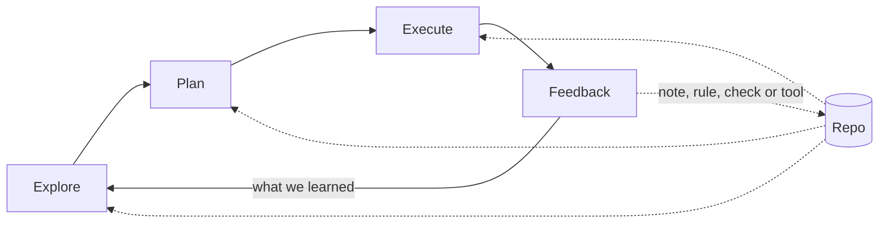

# The delivery loop

> Delivery with agents is one loop: explore, plan, execute, get feedback, and leave something behind in the repo each time round. This chapter shows how to run that loop with plans as files, work as issues and one worker per issue, and how to decide what belongs in a Markdown workflow and what belongs in code.

**Read this when:**
- Your plans live in chat and are gone when the session ends.
- You have a growing pile of skills, scripts and automations and spend more time tending them than shipping.
- You want agents to keep working when your laptop is closed, and want the work to be worth its cost.

## One loop, four moves



- **Explore:** find out what exists and what is possible.
- **Plan:** decide what will be built and how the result will be proven.
- **Execute:** workers build one slice each.
- **Feedback:** evidence from the running product and from people.

The dotted lines matter most. An agent starts every session knowing nothing about the last one. If a pass through the loop leaves no trace in the repo, the next pass pays for the same exploration and makes the same mistake.

## Explore cheaply before you commit

Exploration is the cheapest phase to be wrong in. Use it.

- **Ask for options first**, with effort and reversibility for each. [Intent, specs and decomposition](01-intent-specs-and-decomposition.md) has the prompt.
- **Build a throwaway prototype.** A single HTML file or a `/lab` route in the app lets you experience the behaviour in minutes. If the prototype writes its runs to disk (a JSON result, a screenshot), the coding agent can read them and iterate without you describing what you saw.
- **Compare side by side.** Ask for "now" and "proposed" next to each other: two screenshots, two versions of the handler, the component in each state. Gaps show up faster in a comparison than in a description.
- **Stop where you can no longer verify.** An agent can take you into a library or a domain you do not know. Go as far as these still hold: you can explain the result in your own words, you can name a check for it, two independent explorations agree, and you would sign off on it.

Then make exploration reusable. Keep one short note per feature that records what the code does not say:

```markdown
# Report export

Role: finance teams pull approved reports into their accounting tool.
How to get there: Reports → Export, or `GET /api/exports?month=YYYY-MM`.
How to verify: `npm run seed -- --reports 20`, export, compare with `fixtures/export-v1.csv`.
Keep in mind: columns are only ever added (decision 0002). Editing a report
rebuilds its export row.
```

An agent fixing a bug in "edit report" reads the last line and checks the export too. Initialise these notes yourself, because their first shape sets the pattern. Then let a scheduled agent maintain them, with an instruction to modify and remove as well as add. A stale note is worse than no note.

## Decide how much to plan

| Signal | Just try | Plan in detail |
|---|---|---|
| Reversibility | A revert is one commit | Stored data, a public API, money |
| Blast radius | One screen or module | Several services or teams |
| Unknowns | You will know it is right when you see it | You cannot tell right from wrong by looking |
| Cost of an attempt | Minutes | Hours of agent time and CI |
| Who is affected | You | Customers, other teams |

When an attempt is cheap, the attempt is the plan. If it goes wrong, throw it away and start again with what you learned. Do not patch a bad first try.

When you do plan, the plan says **what** will exist and **how each part is proven**. It does not say how to build it. Keep it short and link out to specs and decisions. Background agents can hunt for edge cases in a plan. The approval is yours.

## Keep plans as files and work as issues

A plan written in chat is gone with the session. A plan pasted into one big issue gets worked top to bottom by a single agent, including the parts that should have waited.

```text
plan.md              the one active plan, reviewed like code
docs/plans/done/     finished plans, each with its issue table
docs/decisions/      decision records the plan must respect
```

```markdown
# Rejection comments

## 1. Store the comment
Done when: a rejected report still has its comment after a reload (integration test).

## 2. Show it to the submitter
Done when: a recording of the report page on the preview build shows the comment.

## Issues
| # | Issue | Blocked by | Worker | Closed |
|---|---|---|---|---|
| 41 | Store the comment | none | codex · medium | 2026-03-04 |
| 42 | Show it to the submitter | #41 | claude-code · low | 2026-03-05 |
```

Splitting the plan into issues is a skill with a hard stop in the middle:

1. The agent reads the plan, the instruction file and the decision records.
2. It drafts the split as a table: title, plan section, scope, done when, blocked by. One issue per unit of work.
3. **It stops and shows you the table.** Nothing is published until you approve.
4. It creates the issues in dependency order, so "blocked by" cites real numbers.
5. It records each issue URL from the tool's output, not from memory.

The split is the plan's real review. If a section cannot be turned into an issue with a checkable "done when", the plan was not finished.

Each worker closes its issue with a fixed comment:

```text
done: comment stored and returned by GET /reports/:id
worker: <harness> · <model> · <effort>
commit: 4f2a9c1
```

After a few plans, the `worker` line shows which model is worth its price for which kind of task.

Two practical notes. If an agent cannot reach the tracker (no CLI, a sandbox without network), write the same issues as files, such as `docs/issues/041-store-comment.md` with the state in frontmatter, and treat the default branch as the tracker. Use one place per plan, never both, because two trackers drift. And on a larger codebase the plan can carry more: save each confirmed plan in the repo, and have it name every pull request the work will open with a size budget for each, which a self-review later enforces.

## Execute with workers

A worker is a fresh agent session that gets one issue and the repo, nothing else.

- **One issue per worker**, each on its own branch or git worktree (a second checkout of the same repo in another folder), so parallel work does not collide.
- **Pick the model per issue.** Use the strongest for logic, a cheaper one for views and mechanical tests.
- **Keep your main session for decisions.** Research, plan refinement and builds run in the background and report back.
- **Stop on drift.** Before a worker adds a type, a file or a route that the plan does not list, it stops and says why. Checking size against the budget after each step turns scope creep into a question, not a surprise at review.
- **Mind the machine.** Parallel agents run builds, test suites and browsers, and they exhaust CPU, memory and disk. Queue the heavy steps, prune finished worktrees on a timer, and ask an agent to audit for stale processes before you buy hardware.

[Subagents and multi-agent patterns](../03-agents/03-subagents-and-multi-agent.md) covers the mechanics. [Orchestrating agent teams](../05-autonomy/03-orchestrating-agent-teams.md) covers standing teams.

## Markdown workflow or code?

A skill is a Markdown file that an agent executes. That makes Markdown a real place to put a workflow, with real trade-offs.

| | Markdown (prompt, skill) | Code (script, CI job) |
|---|---|---|
| Strong at | Varying input, judgment, composing with other skills, moving between harnesses (Claude Code, Codex, Cursor and so on), a two-minute edit | The same result every run, speed, low cost, tests, a clear failure |
| Weak at | Results differ per run, every run pays for everything again, hard to tell which edit helped | Breaks when input varies, costs more to write |
| Use for | Triage, review, research, anything that needs reading | Gates, state transitions, data collection, anything a program can check |

A sequence that works:

1. **Start in Markdown.** A first version can be three sentences: "Have a second model review the change. Address its feedback. Repeat until you both agree." Run it and watch.
2. **Edit it every time it misbehaves.** The usual fixes are an end state ("finish with an open pull request"), a limit ("stop after three rounds"), and a fence ("do not let review feedback widen the scope"). A pair of bad and good examples steers better than a paragraph of description. A skill you use weekly and have not edited in months deserves suspicion.
3. **Move the stable parts into scripts the skill calls.** If the agent rewrites the same data-gathering code each run, save it next to the skill and reuse it.
4. **When the workflow is a fixed sequence of states, make it a program that prints the next instruction.** The skill shrinks to "run this and do what it says":

```markdown
---
name: ship-pr
description: Use when a change is ready to go from draft to merged.
---
Run `node tools/ship.mjs --pr <number>` and do exactly what it prints.
Run it again after each step until it prints DONE.
```

```text
$ node tools/ship.mjs --pr 212
STATE: checks-red
NEXT: `npm run validate` fails in lint (2 errors). Fix them, push, then run me again.
```

The script owns the order of states: checks green, reviewers satisfied, merge allowed by the risk policy, deploy confirmed. The agent gets only the context for the current step, which costs fewer tokens and leaves less room to skip one.

Keep the Markdown side composed of small single-purpose skills (open a pull request, watch a pull request, verify a change) and let a higher-level skill call them. To see how an edit changes behaviour, generate synthetic scenarios and run them through an eval tool such as Promptfoo. See [Skills](../02-workspace/02-skills.md) and [Self-improving systems](../05-autonomy/05-self-improving-systems.md).

## Why a workflow beats a pile of tools

Agents let you build faster than you can keep up. Every tool, automation and background agent adds something to document, test and answer questions about. The symptoms are familiar: an agent waiting on you, a job that failed silently last week, and more of your day going into the system than into the work.

- **Start from the workflow you actually run**, then add the tool it lacks. Do not start from the integrations you could have.
- **Generalise.** One `draft_update(kind, sources)` serves release notes, a changelog and a status mail. Three bespoke tools are three things to maintain. See [Tools and MCP](../02-workspace/04-tools-and-mcp.md).
- **Count usage.** Ask your agent to scan session history for which skills were invoked last month and how often the change merged afterwards. Delete what was not used.
- **Rank removal above addition.** A system that only grows makes its agents worse, because they have more to read and more to confuse.

## Run the loop without your laptop

The requirement is simple: agents that start on a schedule or on an event (an issue opened, a pull request, a webhook) while your machine is closed.

| Option | Good for | Limits |
|---|---|---|
| Cloud agents and routines built into a harness (Claude Code on the web and its routines, Codex cloud, Cursor) | Scale with no operations work | Less control over the environment |
| A CI runner such as GitHub Actions | Event-triggered jobs scoped to one repo | Short jobs, careful secret handling |
| Your own always-on server on a private network | A full environment, long jobs, tools that need a real machine | You operate it |

Whichever you choose, keep a registry of what is active: the routine, where it runs, its trigger and its owner. A routine that fires and nobody knows where it came from is hard to trust and harder to stop. The [always-on remote setup blueprint](../06-field-guides/02-always-on-remote-setup-blueprint.md) gives a reference design for the server option. [Events, hooks and pipelines](../05-autonomy/04-events-hooks-and-pipelines.md) covers triggers.

## Where quality comes from

Not from reading every line. At agent speed nobody can. It comes from three layers, each assuming the one before it will sometimes fail:

1. **Prevent.** Specs, decision records and known building blocks, so the first attempt is close.
2. **Catch.** The agent verifies its own outcome in the running product, deterministic gates block the merge, and a different agent reviews. Tests alone are not enough, because an agent can write tests that pass without the feature working. See [Verification and quality gates](03-verification-and-quality-gates.md) and [PR review with agents](04-pr-review-with-agents.md).
3. **Contain.** Flags, staged rollout and a restore you have tested. See [Learning after release](05-learning-after-release.md).

The piece to invest in first is the environment in which an agent can check its own work: a way to run the app, drive it, and capture what happened.

## Tie the work to business value

It takes one prompt to schedule an agent that writes a report nobody reads.

- **Name the reader and the decision.** Every recurring job states who reads its output and what they decide with it. No reader, no job.
- **Use the model sparingly.** Let code do the scheduling, collection and comparison. Call a model only for the step that needs reading or judgment.
- **Keep direction with people.** Agents handle order, quality and upkeep. What to build next stays a human call, informed by what agents found.
- **Let autonomy follow evidence.** A job earns the right to act alone after its results have been checked several times and held up.
- **Measure outcomes.** Merged pull requests and generated lines are activity. The measure is whether the user's problem went away.

## Common mistakes

- **Planning in chat.** The next session cannot see it. Put the plan in a file and review it like code.
- **One issue for the whole plan.** A single agent works it top to bottom. Split it, and get the split approved before anything is published.
- **Planning what a ten-minute attempt would answer.** When a revert is one commit, try it.
- **Writing the workflow in code first.** You freeze the process before you know it. Start in Markdown and promote what stabilises.
- **Leaving everything in Markdown.** A gate that a model interprets is not a gate. Fixed sequences and checks belong in code.
- **Adding tools without removing any.** Count usage monthly and delete.
- **Background jobs with no reader.** They cost tokens and attention and change nothing.

## Adopt this

| ID | Practice | Applies to | Effort | First step |
|---|---|---|---|---|
| DLV-1 | Keep the active plan in `plan.md`, with a "done when" line for every section | Project | S | Move the plan from your current chat into `plan.md` and add one checkable line per section |
| DLV-2 | Split plans into issues through a skill that stops for human approval of the split | Project, Team | S | Write the five-step split procedure as a skill and run it on one plan |
| DLV-3 | Close every issue with a fixed comment naming what changed, the harness and model, and the commit | Project, Team | S | Add the three-line closing comment format to your instruction file |
| DLV-4 | Build a throwaway prototype before planning any change you cannot judge without seeing it | Workspace | S | Ask your agent for a single-file HTML prototype of the next UI change |
| DLV-5 | Keep one short note per feature: role, how to reach it, how to verify it, what to keep in mind | Project | M | Write the note for the feature with the most regressions |
| DLV-6 | Run one issue per worker on its own worktree and choose the model per issue | Workspace, Team | M | Run the next two independent issues as two parallel worker sessions |
| DLV-7 | Move the fixed sequence of your ship workflow into a script that prints the next step | Project | M | List the states your pull requests go through and script the first two |
| DLV-8 | Review skill and tool usage monthly and delete what was not used | Workspace, Team | S | Ask your agent to count skill invocations in last month's session history |
| DLV-9 | Keep a registry of active routines with trigger, location, owner and reader | Workspace, Team | S | List every scheduled or event-triggered agent you have in one file |
| DLV-10 | Run at least one agent workflow on a schedule or event without your laptop | Workspace, Team | L | Pick the cheapest option in the table and schedule one nightly check |

## Resources

- [Claude Code routines](https://code.claude.com/docs/en/routines): scheduled and event-triggered cloud runs. Check the page for current triggers and limits.
- [Claude Code on the web](https://code.claude.com/docs/en/claude-code-on-the-web): cloud sessions that do not depend on your machine.
- [Codex cloud](https://learn.chatgpt.com/docs/cloud): the equivalent for Codex.
- [GitHub Actions documentation](https://docs.github.com/en/actions): the common place to run event-triggered checks and agents next to a repo.
- [Promptfoo](https://www.promptfoo.dev/): runs scenario sets against prompts and skills so you can see behaviour change after an edit.
- [A public "harness engineering" guide](https://github.com/kody-hq/kody/blob/main/docs/contributing/harness-engineering.md): one project's written loop from intent to enforcement, worth reading as a worked example.
