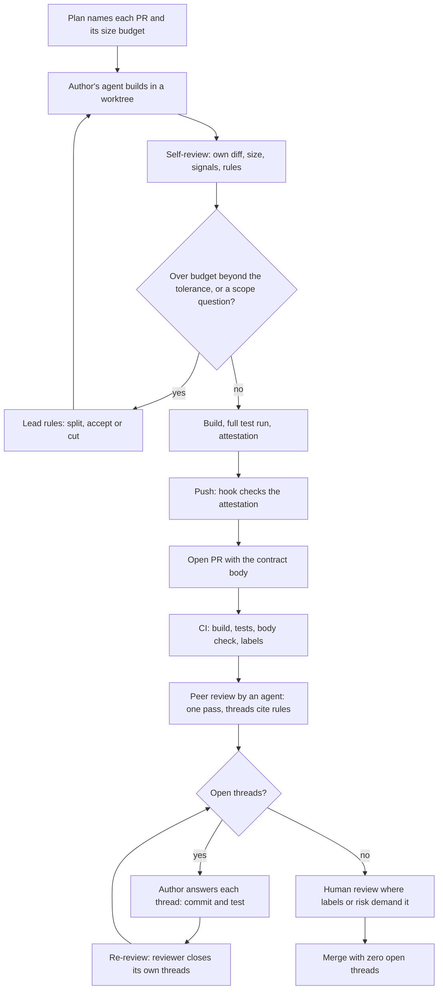

# PR review with agents

> When agents write most of the code, review is where the queue forms. This chapter describes a flow in which the author's agent reviews its own diff before any push, a peer's agent reviews with a small and exact context, every thread ends in a commit and a test, and people spend their attention on scope and on changes that are hard to undo. After reading it you can set up that flow, enforce its first step with a hook, and measure whether it works.

**Read this when:**
- Pull requests pile up faster than your team can read them.
- Agent-written PRs arrive too large, or carry abstractions nobody asked for.
- Your agent reviewer is noisy, expensive or ignored.
- You want a merge rule that holds without someone policing it.

The numbers in this chapter are examples; choose your own. The scripts are minimal sketches to adapt. One role appears throughout: a named person who rules on size and scope, called the lead here.

## Why review becomes the bottleneck

An agent can write a thousand lines in the time it takes you to read a hundred. Generation got cheap; reading did not. A team that adopts agents and keeps its old review process ends up with a growing list of open PRs, reviewers who skim, and merges approved on trust.

Agent output also fails in its own ways:

- **It solves more than was asked.** An interface with one implementation, a mapping layer, an option nobody requested. Each is defensible alone; together they double the diff.
- **It reports success early.** "All tests pass" may mean one folder was tested, or the tests were edited until they passed.
- **It reviews unevenly.** An agent reviewer with no limits either nitpicks everything or approves everything.

So the aim is not to review faster. It is to let less reach review, make what does reach it cheap to judge, and keep people for the decisions only they can make.

## The flow



Make each stage a skill (an instruction file an agent loads on demand; see [Skills](../02-workspace/02-skills.md)), and end each skill by naming the next. Starter versions: [`pre-push-review`](../../templates/skills/pre-push-review/SKILL.md), [`peer-review`](../../templates/skills/peer-review/SKILL.md), [`resolve-threads`](../../templates/skills/resolve-threads/SKILL.md).

## Decide size before the push

"Keep PRs small" fails with agents for two reasons. Raw line counts punish the wrong thing: a little logic with a lot of tests looks huge. And the rule is applied too late: once the code exists, splitting it is rework, so everyone argues to let it through.

### Count effective lines

Measure **effective lines**: hand-written production code added. Removed lines, tests, migrations, generated code and docs do not count. Tests are free on purpose, so nobody trims them to fit a budget. Let a script compute the number, so the plan, the author and the reviewer all mean the same thing. A minimal version:

```bash
#!/usr/bin/env bash
# .claude/scripts/effective-lines.sh [base]
set -euo pipefail
base="${1:-origin/main}"
git diff --numstat "$base"...HEAD -- . \
  ':(exclude,glob)**/tests/**' ':(exclude,glob)**/*.test.*' \
  ':(exclude,glob)**/migrations/**' ':(exclude,glob)**/generated/**' \
  ':(exclude,glob)docs/**' ':(exclude,glob)**/*.md' \
  | awk '$1 != "-" { added += $1 } END { print added + 0 }'
```

Adjust the exclusions to your layout.

### Put the budget in the plan

The plan for a story lists each PR it will produce, with a budget in effective lines (see the [plan template](../../templates/plan-template.md)). Four values make the budget work. Choose each one from your own merged PRs:

| Value | What it does | How to choose it |
|---|---|---|
| Budget per PR | A planned slice above it is split, unless the lead accepts it when confirming the plan | What a reviewer on your team can read with care in one sitting, for example 300 effective lines |
| Tolerance over budget | The self-review refuses to push beyond it without the lead's ruling | Enough to absorb an honest estimate error, for example 25 to 50 percent |
| Cost of one prescribed requirement | Above it, the requirement is a scope question | A small fraction of the budget |
| Cost of an open design choice | Above it, or when it adds a type or a second code path, the choice is a scope question | A larger fraction of the budget |

Size is negotiated once, in the plan, by the person who owns scope. At push time there is nothing to argue about. The building agent also checks the count after each step; finding out at the end that it is at several times the budget is too late.

### Compute signals on the diff

Over-engineering can fit inside a budget. Before hand-off, a second script lists:

- **new types** the diff adds;
- **single-implementation interfaces**: an abstraction with exactly one user;
- **machinery no acceptance criterion forces**: a code path, option or layer that cannot be traced to a line in the ticket.

A signal is a question, not a verdict. The author answers each one in the PR body ("forced by criterion 3") or deletes the code, and the reviewer checks the answers. "It feels over-built" becomes a list both sides can walk through.

## Self-review before any push

The cheapest review happens before anyone else is involved. The author's agent runs a fixed sequence:

1. Read its own diff against the base branch, in full.
2. Check effective lines against the budget, and answer the signals.
3. Check the diff against the rules it touches (see the rule index below).
4. Trace every acceptance criterion to a file or a test.
5. Build, and run the **whole** test suite. A change in shared code breaks tests elsewhere. Zero failures is a hard gate; a test already red on the base branch is reported in the PR body with its ticket key.
6. Write an attestation: a small record that the tests passed on this exact commit.
7. Push, and open the PR with a body that follows the contract.

This does not replace a peer; the agent that wrote the code has blind spots. It removes what a second reader should never see: the leftover debug line, the broken test in another module, the criterion nobody implemented.

### Enforce it with a hook, not with trust

"Always run the self-review first" holds most of the time. In a long session, after context compaction, or with an impatient user, it is the first thing skipped. So make the push depend on the proof: an attestation script runs the tests and writes a record for the current commit into a git-ignored folder, and a hook refuses the push when that record is missing.

In Claude Code this is a `PreToolUse` hook on the `Bash` tool. The harness pipes the pending command to your script as JSON; exit code 2 blocks the call and shows your message to the model. A sketch:

```bash
#!/usr/bin/env bash
# .claude/hooks/require-attestation.sh
# No push and no PR without a passing attestation for HEAD.
set -euo pipefail
command=$(jq -r '.tool_input.command // ""')
case "$command" in
  *"git push"*|*"gh pr create"*) ;;
  *) exit 0 ;;
esac
sha=$(git rev-parse HEAD)
record=".attest/$sha.json"   # written by scripts/attest.sh: {"commit": "...", "failed": 0}
if [[ -f "$record" && "$(jq -r '.failed' "$record")" == "0" ]]; then
  exit 0
fi
echo "Blocked: no passing test attestation for commit $sha. Run the pre-push-review skill. Do not push by hand." >&2
exit 2
```

Hook configuration is version-sensitive; this matches the Claude Code hooks reference as of late 2026, so check it before relying on it. Other harnesses have their own pre-command hooks, and a git `pre-push` hook gives the same guard to people pushing from a terminal. [Hooks, guardrails and security](../02-workspace/05-hooks-guardrails-and-security.md) covers registration and mechanics.

Three things make the guard last:

- **The block message names the next step.** "Run the self-review skill" turns a refusal into the right action. A bare "denied" invites workarounds.
- **If a bypass exists, the skills forbid it.** A hook often has an escape, such as an environment variable for emergencies. The skills say never to set it, never to push by hand and never to open the PR directly.
- **The hook has tests.** A script that can block every push is production code. Keep the hook scripts and their tests together.

An attestation guards against forgetting and shortcuts, not against forgery. CI still runs the build and the tests on every PR.

## Peer review by an agent

A second agent, run by a different engineer, reviews the PR. Its quality depends on what it is given.

| Input | Why |
|---|---|
| The diff, in a separate review worktree (one per PR) | The reviewer reads real files and the reviewing engineer's own work is untouched. |
| The plan | It holds the decisions already made and this PR's budget. Without it the reviewer reopens settled questions. |
| The ticket's acceptance criteria | The definition of done. Each criterion should map to code and to a test that fails without it. |
| An index of the rules the diff matches | Your standards, limited to those that apply. |

The fourth input decides the cost. A mature project can hold dozens of path-scoped rule files (instruction files that load only for matching paths; see [Instruction files and rules](../02-workspace/01-instruction-files-and-rules.md)). Loading them all would fill the context before the diff is read. Have a script compare the changed paths with each rule's `paths:` globs and print one line per match:

```text
rules matched by this diff (open a file only when a finding needs it)
coding-style.md         Naming, layering and error handling for production code
contract-evolution.md   Changing a public request or response type without breaking callers
orders-domain.md        Which states an order can move between, and who may move it
```

The reviewer reads the index and the diff, and opens a full rule only when a finding rests on it.

### One pass, no fan-out

It is tempting to give the review skill a subagent per concern: security, style, tests, architecture. Each subagent loads its own copy of the diff and the context, so the cost of every review multiplies by the number of concerns, and the findings overlap. The wording of such a skill is not what costs; the behaviour it mandates is.

A better default: **single pass, primed with the rule index, no fan-out.** [Subagents and multi-agent patterns](../03-agents/03-subagents-and-multi-agent.md) explains when fan-out pays. A routine PR is not such a case. Keep multi-agent review for the rare change whose risk justifies the bill, and have a person ask for it by name.

### Comments that cite a rule

A finding is useful when the author can act on it without a debate. Ask for threads in a fixed shape:

- a severity: `blocking`, `should-fix` or `note`;
- the rule file and section, or the acceptance criterion, it rests on;
- what to change;
- the test that would prove the fix.

A finding that cannot be tied to a rule, a criterion or a demonstrable defect is a note at most. That removes most reviewer noise. It also shows you where a rule is missing: when the same uncited comment comes up twice, write the rule, or better, a lint check. Feedback that lives only in PR threads is paid for again on every PR.

Give the reviewer limits as well as standards: no comments on what the formatter enforces, no new minor findings in a re-review, no rulings on scope, and anything hard to undo is named for a person.

## Resolve every thread, then re-review

The rule for the author is short: answer every thread with a commit and a test. Each open thread gets one of four treatments:

- **Fix**: write the test that fails because of the finding, make it pass, commit, reply with the commit hash and the test name.
- **Disagree**: reply with the reason, citing a rule, a criterion or the plan. Do not change code just to end the thread.
- **Answer**: when the thread is a question.
- **Escalate**: when doing what is asked would grow the scope.

"Fixed, thanks" with no commit is not an answer. Agents are quick to claim a fix, and a test is the one reply a reviewer can verify without rereading the diff.

Then the reviewer runs the review skill again in re-review mode. It looks only at **its own threads**, checks each named commit and test, and resolves the thread or says what is still missing. The author does not close a reviewer's thread; if the author's agent could, an empty thread list would prove nothing.

The merge rule follows: **a PR merges only with zero open threads.** On GitHub, the branch protection option that requires conversation resolution makes this independent of anyone's memory.

If a PR needs a third round, the cause is usually upstream: the story was not ready, or a scope question was never asked. Go back to the plan.

## A PR body contract checked in CI

Reviewers should not have to dig for the basics. Write the PR contract down as an always-on rule, and let a CI job check every PR body against it. The starter contract is the [PR body template](../../templates/pr-body-template.md): ticket, what changed, size against budget, criteria mapped to code and tests, new machinery and what forces it, tests run, risk and rollback, out of scope. The check can be small:

```js
// scripts/pr-body-check.js: fail the job when the PR body breaks the contract.
const body = process.env.PR_BODY || "";
const required = ["Ticket", "What changed", "Size", "Acceptance criteria",
  "New machinery", "Tests", "Risk and rollback", "Out of scope"];

const problems = [];
for (const heading of required) {
  const match = body.match(new RegExp(`^## ${heading}\\s*\\n([\\s\\S]*?)(?=^## |$(?![\\s\\S]))`, "m"));
  if (!match) problems.push(`missing heading: ## ${heading}`);
  else if (!match[1].replace(/<!--[\s\S]*?-->/g, "").trim()) problems.push(`empty section: ## ${heading}`);
}
if (!/\bPROJ-\d+\b/.test(body)) problems.push("no ticket key (PROJ-123)");

if (problems.length) { console.error(problems.join("\n")); process.exit(1); }
```

In GitHub Actions, run it on `pull_request` events (`opened`, `edited`, `synchronize`) and pass the body through an environment variable (`PR_BODY: ${{ github.event.pull_request.body }}`). Interpolating PR text straight into a `run:` line lets anyone who can open a PR inject shell commands.

The check verifies form, not truth. It still pays: an agent that must fill in "criterion, where it is met, test that proves it" notices the criterion it skipped.

The wider principle: wherever a review comment can become a deterministic check, make it one. The [validate workflow in kody-hq/kody](https://github.com/kody-hq/kody/blob/main/.github/workflows/validate.yml) is a public example with dozens of checks per PR, many of them project-specific scripts. [Verification and quality gates](03-verification-and-quality-gates.md) owns that topic.

## What people still review

Agents do the reading. People keep the decisions.

- **Scope.** The lead confirms each plan and rules on every scope question. The engineer in the session may confirm a summary but cannot grant themselves more scope. An open design choice that the author settles alone tends to come back as rejected code in review, after the cost is paid. An agent reviewer does not rule on scope either; it names the question and stops.
- **Changes that are hard to undo.** Data migrations, public contracts, deletions, anything that touches money or permissions. An agent review is one input and a person approves. A flag that defaults to off makes more changes reversible, which shrinks this category.
- **Core areas.** List your core areas in one file and let CI turn the list into PR labels. A label tells a person "this one deserves your eyes" without asking them to open every PR.
- **Direction.** Whether the feature should exist in this shape. The plan confirmation answers that, before the code.
- **Approvals.** A PR merges with the number of approvals your branch protection requires and zero open threads. Decide explicitly who may approve, and do not let an author's own agent count.

Match depth to risk. A change that only combines existing pieces needs the automated checks. A change to existing behaviour needs tests and a separate reviewer. A change that cannot be rolled back needs a person. Running the heaviest process on a typo fix is how review processes get bypassed.

## Agents that review around the clock

Review does not have to wait for a person to start it. An agent on an always-on machine can watch for open pull requests and review them at any hour, and the author's agent can answer in the same way. What makes this work is how the agents communicate:

- **Through the pull request, never through a private channel.** A finding is a review thread. An answer is a commit plus a reply on that thread. State lives in labels, checks and the approval status. Any agent or person who opens the PR sees the whole conversation.
- **Each agent starts from the PR's current state**, not from memory of an earlier run: which threads are open, who spoke last, what changed since the last review.
- **Only the reviewer closes its own threads**, so an author's agent cannot declare itself done.
- **A person is told only when a decision is needed** or something is broken, not every time a review finishes.

The [always-on remote setup blueprint](../06-field-guides/02-always-on-remote-setup-blueprint.md) covers where such an agent can run. Two ready-made skills cover the routine itself: [`review-queue`](../../skills/review-queue/SKILL.md) for one bounded pass over the open pull requests, and [`after-merge-check`](../../skills/after-merge-check/SKILL.md) for verifying what merged.

## Measure review

Compute PR metrics on a schedule from recorded facts about each PR, and commit each result as a small data file, so the trend sits in the repository where any agent can read it. A suggested starting set (pick three):

| Measure | What it tells you |
|---|---|
| Time from PR opened to first review | Whether reviews start promptly |
| Review rounds per PR | Whether stories are ready and self-review is real |
| Effective lines against budget | Whether plans size work honestly |
| Threads per PR, by severity | Reviewer noise, or author quality |
| QA failures after merge | What review misses |

Read them together. Fewer threads with more QA failures means the reviewer got lenient, not that the code got better. [Learning after release](05-learning-after-release.md) covers what happens after the merge.

## Starter checklist

**Author, before push**
- [ ] I read my whole diff against the base branch.
- [ ] Effective lines are within budget, or the lead accepted the overrun.
- [ ] Every new type or abstraction is forced by a named acceptance criterion.
- [ ] Every acceptance criterion maps to a file and a test.
- [ ] Build and the whole test suite pass on this commit, and the attestation is written.
- [ ] The PR body follows the contract.

**Reviewer**
- [ ] I had the diff, the plan, the acceptance criteria and the rule index, in one pass.
- [ ] Every finding cites a rule or a criterion and says what to change.
- [ ] Scope questions and hard-to-undo changes are named for a person.

**Author, after review**
- [ ] Every thread has a commit and a test, or a reasoned reply.
- [ ] I closed no thread I did not open.

**Merge**
- [ ] Zero open threads, required approvals, CI green including the body check.
- [ ] A person saw every PR with a core-area label.

## Common mistakes

- **Treating the agent reviewer as the only gate.** It shares blind spots with the agent that wrote the code. Keep deterministic checks in CI and a person on irreversible changes.
- **Arguing about size at push time.** The code exists and splitting is rework. Put the budget in the plan and let the self-review enforce it.
- **Counting raw lines.** Authors respond by cutting tests. Count hand-written production lines and leave tests free.
- **Loading every rule into the review.** The context fills with standards that do not apply. Build an index of matching rules and open files on demand.
- **A subagent per review concern.** Cost multiplies and findings overlap. Use one pass with a prepared context.
- **Letting the author close the reviewer's threads.** The merge rule stops meaning anything. The reviewer closes its own threads in a re-review.
- **A body template nobody checks.** Sections are soon left empty. Fail the PR in CI.

## Adopt this

| ID | Practice | Applies to | Effort | First step |
|---|---|---|---|---|
| PRR-1 | Require zero open review threads before merge and enforce it in branch protection | Project, Team | S | Turn on "require conversation resolution before merging" for your integration branch |
| PRR-2 | Add a PR body template with fixed headings and fail the PR in CI when a heading is missing or empty | Project | S | Copy `templates/pr-body-template.md` to `.github/pull_request_template.md` and add the body-check job |
| PRR-3 | Measure PR size in effective lines with a script and give each PR a budget in its plan | Project, Team | S | Add `effective-lines.sh` with exclusions for your test, migration, generated and docs paths and run it on your last five PRs |
| PRR-4 | Have the author's agent run a self-review skill (diff, size, criteria, build, full tests) before every push | Project, Workspace | M | Copy `templates/skills/pre-push-review/SKILL.md` and fill in your base branch, build and test commands |
| PRR-5 | Block agent pushes that lack a passing test attestation for the current commit | Project | M | Add an attestation script and a harness or `pre-push` hook that checks its record and names the skill to run |
| PRR-6 | Give the review agent only the diff, the plan, the acceptance criteria and an index of matching rules, in a single pass with no subagents | Project | M | Write a script that prints one line per rule file whose path globs match the changed files |
| PRR-7 | Require every review finding to cite a rule or an acceptance criterion, and write a rule when the same uncited comment appears twice | Team | M | Add the severity and citation format to your review skill |
| PRR-8 | Answer every review thread with a commit and a test, and let only the reviewer close its own threads | Team | M | Copy `templates/skills/resolve-threads/SKILL.md` and agree the thread-closing rule |
| PRR-9 | Name one person who rules on scope and send scope questions to them before the code is written | Team | S | Write the name and your scope-question thresholds into the shared instruction file |
| PRR-10 | Let review agents run around the clock and talk only through the pull request (threads, commits, labels), and track PR metrics over time | Team | L | Start one review by an agent on a schedule and check that everything it said is visible on the PR |

## Resources

- [Claude Code hooks reference](https://code.claude.com/docs/en/hooks): the events, the JSON a hook receives and how exit codes block a tool call. Check it before copying the push hook.
- [Git hooks documentation](https://git-scm.com/docs/githooks): `pre-push` and the other client-side hooks, for a guard that also covers a plain terminal.
- [About pull request reviews (GitHub Docs)](https://docs.github.com/en/pull-requests/collaborating-with-pull-requests/reviewing-changes-in-pull-requests/about-pull-request-reviews): review states, threads and required reviews.
- [Claude Code GitHub Actions](https://code.claude.com/docs/en/github-actions): running an agent reviewer from CI or from a PR comment.
- [Cursor Bugbot](https://cursor.com/docs/bugbot) and [CodeRabbit](https://www.coderabbit.ai/): hosted agent reviewers, useful as a comparison for your own review skill.
- [kody-hq/kody validate workflow](https://github.com/kody-hq/kody/blob/main/.github/workflows/validate.yml): a public example of a large deterministic gate with project-specific checks.
