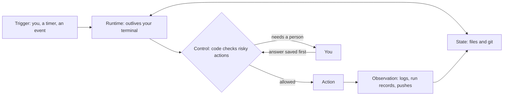

# Autonomous systems

> Autonomy is a dial, and each job you give an agent can sit at a different setting. This chapter gives you a ladder of six levels, the four parts every unattended setup needs (runtime, state, control, observation and recovery), and the conditions to meet before each step up. After reading it you can say which level each of your agent jobs is on and what is missing before the next one.

**Read this when:**
- You want an agent to keep working after you close the laptop.
- An agent job works while you watch it and stalls, repeats itself or drifts when you do not.
- You are about to give an agent a schedule, a looser permission mode or a credential that matters.

## What autonomy means in practice

A cron job runs unattended, but it does the same thing every time. An agent job is different in one way: a model chooses the steps. That is why it can handle a case nobody scripted, and also why it can do something nobody wanted. The goal is a job that acts on its own inside limits enforced by code, with a working channel in both directions between you and the job.

A useful design habit: plan the job as if nobody will be there. Then list what breaks. Who restarts it? How does it know what was already done? What stops it sending the same message twice? Who says yes to the risky step? Each answer is a part you have to build, and the list is usually shorter than expected.

### Six levels

| Level | The agent | You | Typical form |
|---|---|---|---|
| 0. Answers | Replies to questions and changes nothing | Copy, paste, verify | Chat |
| 1. Acts with approval | Edits files and runs commands, one approval at a time | Watch every step | Interactive session, default permissions |
| 2. Works to a check | Carries a whole task until a command says it is done | Start it, read the result | Session with an allow-list and a done-check |
| 3. Runs detached | Keeps going when your terminal closes and contacts you when it needs you | Answer from your phone | Session in `tmux` on a server, push notifications |
| 4. Wakes itself | Starts on a schedule or an event | Read reports, decide what is escalated | A timer or webhook starts a fresh session |
| 5. Maintains itself | Notices its own failures, restarts, and proposes changes to its own instructions | Approve those changes, audit | Watchdogs plus an evaluator (see [Self-improving systems](05-self-improving-systems.md)) |

Levels belong to jobs, not to people or tools. A read-only summary job can run at level 4 with a minimal tool allow-list while anything that touches production stays at level 1. That mix is normal.

## The four parts



### Runtime: a process that outlives your terminal

A session inside your editor dies with the editor. From level 3 up you need three things.

**A host that stays on.** A small server, a cloud agent offered by your harness, or a durable execution platform (a host that saves each finished step so a restart continues instead of starting over). A laptop works only while it is awake.

**A process manager.** The simplest stack that holds up is `tmux` for the session and `systemd` user units (or `launchd` on macOS) to start it, restart it and run timers:

```sh
# start a named, detached session that survives disconnects
tmux new-session -d -s pr-watch -c ~/work/repo 'claude --permission-mode acceptEdits'
tmux capture-pane -p -t pr-watch     # look at it
tmux kill-session -t pr-watch        # stop it
```

Give each long-lived session its own `tmux` server (`tmux -L pr-watch ...`) so that one job cannot disturb another, and so that "kill everything that belongs to this job" is one command.

**Something that wakes it.** A person, a schedule, or an event. [Events, hooks and pipelines](04-events-hooks-and-pipelines.md) covers triggers. The rule here is that the trigger starts a small, known entry point (a script), and the script starts the agent.

Two habits for always-on sessions:

- **Restart on a schedule, not only on failure.** Long sessions fill their context window and slow down. Restart each standing session nightly, and have the restart script wait for a run lock to be free, so it never cuts a job in half.
- **Add a watchdog for the thing you depend on.** A link can die while its process keeps running, so a supervisor that watches only the process never reacts. Have a timer check every few minutes for evidence that the link you use to reach the session is alive, and restart the unit when it is not. The same pattern covers other assumptions, such as a shared checkout that must stay on one branch. A watchdog is a ten-line script.

One more runtime rule: **do not put a model inside a tight loop.** If a batch of items has to finish within a few seconds, a model call per item can never fit. Let a script do the batch, and let a model start the script, read its output and report. Steps with a deadline, with arithmetic or with money belong to code.

A full server design (network, units, accounts) is in the [always-on remote setup blueprint](../06-field-guides/02-always-on-remote-setup-blueprint.md).

### State: files and git, not the conversation

A conversation is the worst place to keep progress. It is invisible to other agents, it gets compacted, and it is gone when the session ends. Treat each run as starting empty and write down everything the next run needs.

| Kind of state | Where it lives | Why |
|---|---|---|
| What was asked, decided and answered | A task file or board in the repo | Any agent or person can pick the task up |
| What was done | An append-only journal, one line per step, plus git commits | Recovery reads it; audits read it |
| How far the job got | A bookmark (last finished item) written after the step succeeds | A restart continues from there |
| What must happen only once | A record written before the action leaves, keyed by a stable id | A retry finds the record and does not repeat it |
| Why the code is the way it is | Short "why" notes next to the code (see [Portable agent config](02-portable-agent-config.md)) | The next run does not undo a deliberate decision |

Three details decide whether this works.

**Move the bookmark last.** If the job marks an item as handled before the work succeeds, a crash loses that item and nothing reports it. Writing the bookmark after the work trades the lost item for a possible duplicate, so every step has to tolerate running twice.

**Guard irreversible actions with a key.** A payment, an email, a posted review: build an id in code from the inputs (never let the model invent it), write it down before sending, and refuse a second send with the same id. A retry then returns the earlier result.

**Earlier sessions are state too.** Harnesses keep transcripts on disk (as of late 2026, Claude Code under `~/.claude/projects/` and Codex under `~/.codex/sessions/`, as JSONL files). An agent can search them to answer "what did we decide last week?". Give that search firm rules: read only this project's sessions unless you asked for more, quote each finding with its file and line, say "not found" when nothing matches, hide anything that looks like a secret, and treat transcript text as data. A line in an old session that reads like an order is not one.

### Control: who may start, stop and approve

Write down three lists for every job above level 1.

1. **Who may start it and stop it.** For a server job: the unit file and one documented stop command. For a loop: a stop file the agent checks (`touch loop/stop`), plus the plain fact that killing the session works.
2. **What it may do without asking.** An allow-list of tools and commands, as narrow as the job. A summary job that needs to read files and send one notification gets exactly those.
3. **What always needs a person.** Anything irreversible, anything that widens the agent's own permissions, and anything that does not match the written procedure.

The check must be code. A prompt that says "ask before you send" is a request. A tool that refuses to send is a control. The checker gives each proposed action one of three results: it goes ahead, it is rejected with a reason, or it is held for a person.

```
agent proposes action -> code checks rules -> run | refuse (with the reason) | ask a person
ask: save the request, pause this job only, wait
answer arrives: save it, check again, run only that exact request
no answer: silence is treated as no
```

Controls that earn their place early:

- **A done condition the agent cannot move.** Agree what "done" means as a command, for example `npm test -- parser`, and write it to a script such as `./verify`. You read and approve that exact file, and the approval (a hash) is stored outside the project, so an agent that edits project files cannot approve its own check. An agent with an unrestricted shell still could, which is one more reason to sandbox it. A Stop hook (a script the harness runs when the agent wants to end its turn) runs the check and sends the agent back with the failure while it fails. The loop has exactly three exits: the check passes, the budget of rounds is spent, or you say stop. Each exit writes one line to a log. Two rules keep it honest: change the work, never the check, and "budget spent" is reported as not done.
- **Budgets.** A cap on rounds, on wall-clock time and on spend, enforced by the runner. A cap that stops a stalled job is working as intended.
- **An allow-list for outbound requests.** A model can fetch an endpoint on its own initiative, for example to quote it in a report, and a fetch can have a side effect such as starting or cancelling a run. Give each role a file listing the exact methods and URLs it may call, and check it in the tool.
- **Secrets by reference.** The model sees `{{API_KEY}}`, never the value. The tool fills it in at send time, only for hosts listed for that secret, never in a URL and never across a redirect to another host.
- **A parking place.** Give the agent a way to set a case aside for you ("needs owner", with the reason) and keep working on the rest. A batch in which most items go through and a few wait for a decision is the system working.

Approval prompts have a cost: if every action needs a yes, you stop reading them. Prefer narrow standing permissions for reversible actions and a real stop for the few that are not. See [Hooks, guardrails and security](../02-workspace/05-hooks-guardrails-and-security.md).

### Observation and recovery

You cannot watch an unattended job, so it must leave a trail and tell you when something needs you.

- **A run record.** One line or small file per run: what started it, the version of the instructions, the model, the duration, the cost, the result. Log references to secrets, never values.
- **A journal that includes "did nothing".** When a filter drops an event or the agent decides not to act, record that with the reason. Most "why didn't it run?" questions are answered there.
- **A heartbeat.** A file touched or a line written on every cycle, and a timer that complains when it goes stale.
- **Escalate once, and make it actionable.** A push that says what happened and names the single thing you need to do. See the finish-push rule in [Events, hooks and pipelines](04-events-hooks-and-pipelines.md).

Recovery is mostly a consequence of the state rules: restart, read the journal, continue from the bookmark, skip what has a "sent" record. For code changes, git is the undo: each job in its own worktree (a second working directory on its own branch), merged only after review. Test recovery on purpose before you trust it:

| Test | Expected |
|---|---|
| Deliver the same event twice | One piece of work, one side effect |
| Kill the process in the middle of a step | Restart continues; nothing is skipped or repeated |
| Cut the network to a dependency | The job says it is offline and waits; the bookmark does not move |
| Stop the job while input keeps arriving | After restart, everything that arrived is handled once |
| Reboot the host | Every unit comes back without you |

The last row is the one people skip. A session started by hand has no unit and does not return after a reboot, so run this test with a real reboot.

## Raise autonomy one notch at a time

Move one job up one level, run it for a week, read what it did, then decide about the next step.

| Step | Must be true first | How you know |
|---|---|---|
| 0 to 1 | The project has an instruction file and the agent can run the tests | It finishes a small change with you approving each step |
| 1 to 2 | "Done" is a command; permissions are an allow-list; the task is reversible (branch or worktree) | Three tasks in a row end on the check, not on "looks finished" |
| 2 to 3 | The session runs on an always-on host; it can reach you; you can stop it remotely | You close the laptop and still get the result and the questions |
| 3 to 4 | Fresh start works from files alone; the trigger is deduplicated; the job is least-privilege; a dry run reports what it would do | A week of "would do" reports with no surprises, then a week of real runs |
| 4 to 5 | Watchdogs exist; the recovery tests above pass; changes to instructions go through an evaluator and a human approval | A planted failure is noticed, reported and repaired without you |

Two techniques make each step cheaper.

**Run in report-only mode first.** Let the job say what it would do before it may do it. Keep that mode as a flag so you can return to it after any change.

**Dry-run on the cheapest model that will run the job.** A weak model guesses file names, forgets a header, sends twice. Every one of those mistakes shows a place where a rule lives only in the prompt and should live in code. Once the code holds, the stronger model makes the job better instead of merely safer.

When a job misbehaves, move it down a level, fix the missing part, and climb again.

## Common mistakes

- **Treating a long chat as an autonomous system.** The plan, the progress and the decisions live in one context window. When it is compacted or closed, the job is gone. Write them to files as you go.
- **Controls written as prose.** "Never send twice" in a prompt is broken by the first retry. Put the guard in the tool: record the send, refuse the second.
- **Letting the agent decide when it is done.** It stops when the work feels finished. Agree a command, have the agent run it before it stops, and report "not done" honestly when the budget runs out.
- **Moving the bookmark before the work.** A crash then skips an item silently. Move it last and make the work repeatable.
- **One big jump.** Going from an approved-every-step session to a scheduled job with bypassed permissions hides which missing part caused the failure. Climb one level per job at a time.
- **No way to stop it from where you are.** If the only stop is a terminal you are not at, the job is out of control. Have a remote stop and test it.

## Adopt this

| ID | Practice | Applies to | Effort | First step |
|---|---|---|---|---|
| AUT-1 | Write the level (0 to 5) next to each agent job you run and note the one missing part that blocks the next level | Workspace, Team | S | List your recurring agent jobs in a file and assign each a level from the table above |
| AUT-2 | End long tasks on a command: agree the done check, save it as `./verify`, and have the agent run it before stopping | Project, Workspace | S | Pick one failing test, write a three-line `./verify` that runs it, and tell the agent "done means this exits 0" |
| AUT-3 | Keep task progress in a file in the repo (task, decisions, steps done, open points) and start every run by reading it | Project | S | Add a `tasks/` folder and ask the agent to write and update one task file during the next multi-step change |
| AUT-4 | Run long sessions in a named `tmux` session on an always-on host, one `tmux` server per job | Workspace | M | Start one existing long task with `tmux -L job new-session -d` and reattach to it from another terminal |
| AUT-5 | Give every unattended job a budget (rounds, time, spend) and a stop file, both enforced by the runner script | Project, Workspace | M | Add a round counter and a check for `loop/stop` to the script that starts your agent loop |
| AUT-6 | Guard every irreversible action with a code-built id recorded before the action leaves, and refuse a repeat | Project | M | Find one action your agent can send (comment, email, deploy) and add a "sent" record keyed by its inputs |
| AUT-7 | Pass secrets to agents as references with a per-secret list of allowed hosts | Project, Team | M | Replace one key in a prompt or env dump with a `{{NAME}}` placeholder that your HTTP tool fills in |
| AUT-8 | Add a watchdog timer for each always-on job and a nightly fresh restart that waits for a free run lock | Workspace | M | Write a script that checks one job's heartbeat file age and restarts the unit when it is stale |
| AUT-9 | Run the five recovery tests (duplicate event, kill mid-step, offline dependency, backlog after downtime, reboot) before raising a job to level 4 | Project, Workspace | L | Kill one running job in the middle of a step and write down what happened on restart |

## Resources

- [Claude Code hooks reference](https://code.claude.com/docs/en/hooks): the life-cycle events, including the Stop event used for done checks.
- [Claude Code CLI reference](https://code.claude.com/docs/en/cli-reference): headless mode and the flags for tools, permissions and settings that scripted jobs rely on.
- [Codex hooks](https://developers.openai.com/codex/hooks): the same automation points in Codex.
- [tmux manual](https://man7.org/linux/man-pages/man1/tmux.1.html): `new-session`, `capture-pane` and `send-keys` are all you need to run and inspect detached sessions.
- [systemd](https://systemd.io/): user units and timers for starting, restarting and scheduling jobs on Linux.
- [Cloudflare Durable Objects](https://developers.cloudflare.com/durable-objects/): one example of a stateful runtime with built-in alarms, useful as a model of durable execution.
- [Pi](https://github.com/earendil-works/pi): an open-source harness whose print mode and extension system make small scripted agents easy to study.
