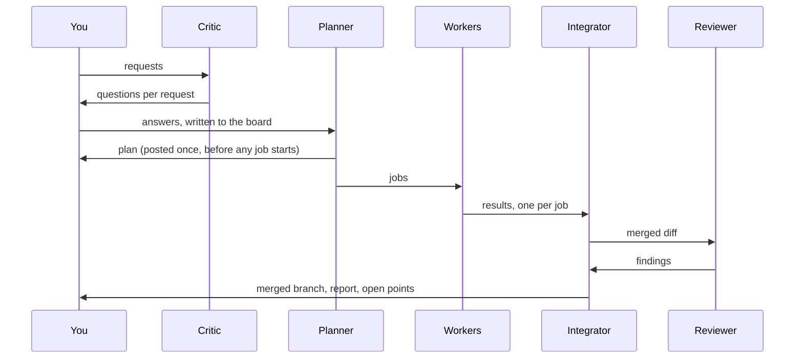

# Orchestrating agent teams

> A standing team is a fixed set of role agents (planner, worker, critic, integrator, reviewer) that take requests and deliver merged, checked changes with you in the loop only where you are needed. This chapter shows how to organise such a team, coordinate it through files and a shared board, run workers in parallel without collisions, supervise it, and count what it costs. After reading it you can run a small team on a real change and know when a team is the wrong tool.

**Read this when:**
- One agent session is no longer enough and you are about to run several in parallel.
- Parallel agents have overwritten each other's work or produced changes that do not fit together.
- You want to hand a batch of changes to agents and review results, not keystrokes.

How a single agent spawns subagents, and the general multi-agent patterns, are in [Subagents and multi-agent](../03-agents/03-subagents-and-multi-agent.md). This chapter is about running a team that persists across tasks.

## Decide whether you need a team

A team multiplies output and also multiplies assumptions. Writers working side by side cannot see one another's choices. Before you build one, check the cheaper options.

| Situation | Use |
|---|---|
| The task and the code it touches fit in one context | One session. Anything more is over-building |
| The task needs research or advice from several angles, but one coherent change | One writer, parallel read-only helpers that report back |
| Several independent changes that touch different files | A team with parallel workers |
| Several changes that all touch the same core file | A team, with that file owned by one integrator |

The second row deserves emphasis. Many setups stop there on purpose: agents run in parallel only to read, search and advise, and one session writes every change. You lose some speed and avoid a whole class of merge and consistency problems. Move to parallel writers when the work really is separable.

## Roles and their limits

A role is defined by what it reads, what it may write and what it must never do. Keep the "never" explicit. It is what lets you trust the role without watching it.

| Role | Reads | Writes | Never | Model tier |
|---|---|---|---|---|
| Critic | One request, the code it touches | Questions for the request's owner (a handful at most) | Writes code, plans, argues with the request | Small |
| Planner | Requests, the owner's answers, "why" notes, the affected code | One plan: jobs, files per job, instructions per job | Writes code, claims a job, merges | Medium to strong |
| Worker | Its job, its files, the plan's instructions | Only the files its job lists | Touches another job's files, merges, approves | Depends on the job |
| Integrator | The plan, every job's result | The shared files, merge commits | Rewrites a worker's change instead of sending it back | Strong |
| Reviewer | The merged diff, the requests, "why" notes | Findings: flag or pass, with reasons | Edits anything | Different model from the worker if you can |

Each role is a folder with a prompt, a run script and its own limits, as described in [Portable agent config](02-portable-agent-config.md). Role prompts written for unattended work need one extra line that is easy to forget: nobody reads your messages while you work, so do not ask questions; do the steps and write the report. Without it, a headless role stops and waits for an answer that never comes.

The roster need not be fixed for ever. A coordinator can assemble a short-lived specialist for one task from a template plus instructions written at spawn time. Start with fixed roles anyway. You can only loosen a structure you understand.

## Coordinate through files and a board

Agents in a team should not chat. A conversation between agents is unreviewable, it disappears, and it cannot be picked up by a replacement. Coordination goes through a shared board: files in the repository, or an issue tracker, or a small service with the same shape.

```
board/
  requests.md          # what was asked, one id per request
  answers/r2.md        # the critic's questions and the owner's answers, verbatim
  plan.json            # jobs: id, owner, files, instructions, model
  claims/w-fee/        # exists = claimed; holds who and until when
  results/w-fee.md     # what changed, evidence, open points
```

The flow:



Take a small room-booking service and three requests: add a cleaning buffer after each booking, charge a late-cancellation fee, and let members book further ahead.

**Unclear requests go to the critic first.** "Charge a late-cancellation fee" hides at least four decisions: how late, how much, who is exempt, from which date. The critic asks. You answer. The answers are written to the board exactly as given, next to a plain reading of what "build it as written" means for requests you did not comment on. A one-line request can hide a cap, a rule about how it combines with another charge, and a start date that only the owner knows. No amount of code reading finds those.

**The plan is by files.** The planner cuts the work so that every path belongs to exactly one job:

```json
{
  "jobs": [
    { "id": "w-buffer", "owner": "worker", "request": "r1",
      "files": ["src/booking/rules/cleaning-buffer.ts"],
      "asks": ["Export bufferMinutes(room): number.",
               "15 for every room. Example: a booking ends 10:00, the next may start 10:15."] },
    { "id": "w-fee", "owner": "worker", "request": "r2",
      "files": ["src/booking/rules/late-fee.ts"],
      "asks": ["Export lateFeeCents(booking, cancelledAt): number.",
               "Copy the numbers and dates from answers/r2.md exactly."] },
    { "id": "w-window", "owner": "worker", "request": "r3",
      "files": ["src/booking/rules/member-window.ts"],
      "asks": ["Export maxDaysAhead(user): number."] },
    { "id": "merge", "owner": "integrator", "request": "merge",
      "files": ["src/booking/availability.ts", "src/booking/cancel.ts"],
      "asks": ["Import the three functions and call them here. List every caller you had to touch."] }
  ]
}
```

Four planning rules carry most of the weight:

1. **One owner per file.** Two jobs never list the same path. Each worker runs in its own copy of the repository, and two edits to one file do not merge by themselves.
2. **A file that several requests need goes to the integrator, and to nobody else.** Workers write new, self-contained pieces (a function that takes plain values and returns a value). The integrator wires them into the shared file.
3. **A job must be doable from its request, its files and its instructions alone.** Numbers, dates and limits are copied from the owner's answers, with one worked example. If the planner would have to guess, it stops and reports what is open.
4. **The plan names the callers.** If the merge job lists only the core module, scripts elsewhere that call a function whose signature changes are left out, and the gap shows only when someone reads the diff. A plan should list every file that calls what a job changes, or say how the job covers them.

Check the plan with a script before it is posted: shape, every request served, exactly one merge job, no shared path, no protected path (role tools, secrets, the board itself). Post it once. A planner that can re-post can also quietly rewrite the rules after work has started.

**Claims prevent double work.** A worker claims its job before it changes anything. A claim must be atomic (`mkdir board/claims/w-fee` fails if the directory exists) and should carry a lease: who, and until when. If the agent dies or hangs, the lease expires and the job is free again.

## Route work

Routing is the decision "which role, which model, which environment" for each job. Three signals are enough to start.

- **Path.** Who owns the files? A table of globs to owners (the same idea as a `CODEOWNERS` file) lets a hook or the planner send work, and advice, to the right place.
- **Risk.** Reversible, local changes can go to a worker on a small model. Anything that moves money, deletes data or changes a public contract gets the strong model and a human decision.
- **Cost and speed.** Reading, searching and summarising go to small, fast models. Planning across files and merging go to the strongest one.

Keep the role-to-model map in one file and have every result state the model it actually ran on. Then the plan, the launch and the report cannot disagree, and you can compare runs when you change a tier.

Agents route better when they know the state of the system. What is happening right now (which jobs are running, stuck or failed, and who owns which files) is short and should be pushed into each session. What is possible, what the project is, and what work is planned are larger and belong in files or behind a tool the agent can open when it needs them.

## Run in parallel without collisions

| Mechanism | What it prevents | How |
|---|---|---|
| A worktree per job | Workers seeing each other's half-finished edits | `git worktree add ../repo-w-fee` (or `claude --worktree <name>`), one job per directory |
| One writer per file | Merge conflicts and silent overwrites | The plan, checked by script; a file guard that refuses writes outside the job's list |
| An integrator that merges | Each worker "fixing" the shared file its own way | Only the integrator's job lists shared files; it applies each job's diff and commits it separately |
| Claims with a lease | Two agents on one job; a dead agent blocking a job | Atomic claim, expiry |
| Results as diffs | "Done" with nothing to show | Each job posts its diff and the paths it touched; the board rejects paths outside the plan |

Practical notes:

- A worktree is an isolated checkout. It is not a security sandbox. An agent in a worktree has the same access as your user account.
- Files that git ignores do not come along. If a role needs the variables file, a script copies it into the worktree and removes the worktree when the job ends. Every leftover worktree is a leftover copy of your secrets.
- Have the integrator commit each job's change as its own merge commit. Its own result then contains only its own edits, and you can revert one job without the others.
- Check after each merge, not once at the end. A defect is far cheaper to place when only one job's change is new.
- Give the reviewer the requests. A reviewer that knows the "why" notes but not what was asked flags each requested change "because no note asks for it". A role can only judge against what it was given.

## Supervise

Supervision is a design question: what do you see, when are you interrupted, and how do you stop something.

**What you see.** A team should be readable at a glance: how many jobs, which state, who owns what. A board file or tracker gives you that for nothing. Add one aggregated report per batch, written by the integrator: what changed in the product, what was proven and how, what needs a decision. Reading five worker transcripts is not supervision.

**When you are paged.** Three cases only:

1. A decision only you can make: an unclear request, a conflict between two areas, anything irreversible.
2. Something is broken and the team cannot fix it within its limits.
3. The batch is finished and ready for review.

Everything else goes to the board. Push rules are in [Events, hooks and pipelines](04-events-hooks-and-pipelines.md).

**Progress lives outside the agents.** Job state is kept on the board or in a database. If the coordinator's session vanished now, a fresh agent should be able to continue every job from what is written down.

**Stopping a runaway.** Have all of these before you start:

- A timeout per role run and a budget per job, enforced by the launcher.
- A stop that works from where you are: kill the session, or a stop file each role checks.
- One-send guards on anything that counts once (a posted plan, a review, a merge).
- A harness permission layer that refuses commands which lift a role's own guard. A coordinating session may try, for example, to re-post an amended plan by moving the "already posted" record aside. The permission check should refuse, and the amendment should go to the integrator as an instruction.

## One human, many agents

The practical limit is your attention. Past a handful of sessions you cannot follow each one, and you should not try. The arrangement that scales is:

- You talk to **one coordinator** per project, in one continuous conversation. Voice works well for this, because it forces the system to deliver results you do not have to read line by line.
- The coordinator starts workers, each in its own worktree and pane, and they report back through the board or a webhook.
- You can attach to any worker session directly. You rarely need to.

[Limen](https://github.com/overment/limen) is a small open-source harness built on exactly this shape: files, git and one CLI. It describes itself as experimental, so read it for the design more than for stability. You describe a task to an agent, it plans, starts jobs in separate git worktrees (each with its task, branch, log, state and session), requests review, and you approve merges. One of its ideas is worth copying into any setup: every job keeps a short note that states what "done" means, with how each point will be shown, the one rule that the quickest path would skip, and what is not proven yet. Before a job may finish, it must mark each point as proven or not, with evidence. A finished job with open points is reported as such.

A workspace manager such as [Herdr](https://herdr.dev/) or plain `tmux` gives each agent a pane and gives the coordinator a command line to open panes, read their text and send keys. That is the whole mechanical requirement.

## Count the costs

- **Tokens.** Every role starts cold and re-reads the board, the notes and the code. Small models for narrow roles keep this low. The strongest model for every role costs a multiple and gains little for the critic and the workers.
- **Wall-clock time.** Model time is only part of it. Builds, tests, queues, rate limits and tool calls that hang can take as much again. Measure where a week of team time went before you buy more parallelism. The bottleneck is frequently the test suite.
- **Coordination overhead.** A plan, claims, merges and a review are fixed costs. For a one-file fix they exceed the work.
- **Review load.** Ten parallel workers produce ten diffs. If a person must read every line, you have moved the queue, not removed it. See [PR review with agents](../04-delivery/04-pr-review-with-agents.md).
- **Provider reliability.** A team makes many calls, and a batch stalls when the provider is overloaded or the tier's rate limit is lower than the batch needs. Check the tier's limits against the calls a batch makes, and configure a fallback provider or tier for outages before you depend on a team.

## Common mistakes

- **Parallel writers on shared files.** The merge becomes the real work, and the result is inconsistent. Plan by files and give the shared file to one integrator.
- **Building before asking.** Three workers implement three different readings of a one-line request. Send unclear requests through a critic and get the owner's answers in writing first.
- **Coordination by chat.** Decisions made in agent-to-agent messages are lost when a session ends. Put them on the board.
- **A reviewer without the brief.** It flags the requested change as unexplained. Give every judging role the requests and the answers.
- **Progress only in the coordinator's context.** One compaction or crash and nobody knows what is finished. Keep job state in files.
- **No stop.** A looping role with no timeout and no budget runs until you notice the bill. Set both in the launcher.
- **Leftover worktrees.** They hold stale branches and copies of ignored files. Remove them when the batch ends.

## Adopt this

| ID | Practice | Applies to | Effort | First step |
|---|---|---|---|---|
| ORC-1 | Send every unclear request through a critic that asks a handful of questions at most, and write the owner's answers to a file before any code changes | Project, Team | S | Take your next vague request, have a read-only agent list its open questions, and save your answers in the repo |
| ORC-2 | Run each parallel job in its own git worktree and delete the worktree when the job is merged | Project, Workspace | S | Run `git worktree add ../repo-job1` and start one agent there |
| ORC-3 | Plan by files: one owner per path, shared files to a single integrator, callers listed | Project, Team | M | For your next multi-part change, write a `plan.json` with a `files` list per job and check that no path repeats |
| ORC-4 | Keep job state on a board in files (requests, answers, plan, claims, results) instead of in agent conversations | Project, Team | M | Create `board/` with `requests.md` and have agents append results there |
| ORC-5 | Write each role's "never" line and enforce it with tool limits (read-only critic and reviewer, file guard for workers) | Project | M | Start your reviewer with only read tools and confirm an edit attempt is refused |
| ORC-6 | Set the role-to-model map in one file and have every result state the model it ran on | Project, Team | S | Add `models.json` and print the model in each role's last line |
| ORC-7 | Give every role run a timeout and every job a budget, and keep one documented stop command | Workspace, Team | S | Add a timeout to your launcher script and write the kill command in the README |
| ORC-8 | Have the integrator merge one job at a time, check after each merge, and produce one aggregated report | Project, Team | M | After the next parallel batch, ask for a single report: what changed, what was proven, what needs a decision |
| ORC-9 | Measure where a week of agent team time went (model, builds, tests, queues, hung tools) before adding more parallel workers | Team | L | Log start and end times per tool call for one batch and total them by category |

## Resources

- [Limen](https://github.com/overment/limen): a minimal one-human-many-agents harness built from files, git and one CLI; read it for the job, note and review mechanics.
- [Herdr](https://herdr.dev/) and its [repository](https://github.com/herdrdev/herdr): a workspace for running many agent sessions in panes, with a command line agents can drive.
- [git worktree](https://git-scm.com/docs/git-worktree): the isolation mechanism behind parallel jobs.
- [Pi](https://github.com/earendil-works/pi): an open-source harness whose print mode makes one-shot role runs simple to script.
- [Claude Code CLI reference](https://code.claude.com/docs/en/cli-reference): headless runs, per-run tools and worktree options for role sessions.
- [Langfuse](https://langfuse.com/): open-source tracing for seeing what many agents did and what it cost.
