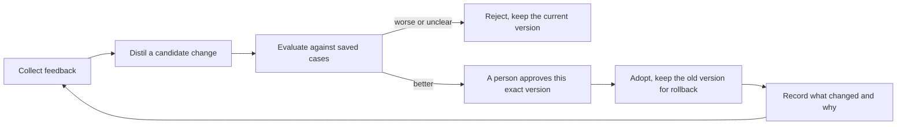

# Self-improving systems

> An agent setup improves when its mistakes are collected, turned into candidate changes, tested, and adopted only if they help. This chapter shows how to close that loop: where feedback comes from, how to decide whether a correction becomes a rule, a skill, a hook or nothing, how to evaluate a change to prompts and rules before it goes live, how to optimise for cost and speed, and how to govern shared instructions so they do not rot. After reading it you can run a monthly improvement cycle that leaves your setup smaller and better.

**Read this when:**
- You have corrected an agent for the same thing three times.
- Your instruction file keeps growing and nobody dares delete a line.
- You want to change a shared prompt, skill or rule and cannot say whether the change made things better.

Building evals and tracing for an agent you develop is covered in [Reliability, observability and evals](../03-agents/04-reliability-observability-evals.md). This chapter uses those tools as a feedback loop on the setup itself.

## The loop



Two ideas carry the whole chapter. Every change to a prompt, rule, skill or hook is a candidate until evidence clears it. And the thing that judges a change sits outside the thing being changed.

You can run this loop by hand once a month and get most of the value.

## Collect feedback

Feedback already exists in your setup. Most of it is thrown away.

| Source | What it tells you | Cheap way to capture it |
|---|---|---|
| Corrections you type ("no, use the existing helper") | A missing or ignored instruction | Search session transcripts for your own repeated phrases; or let a side agent propose a one-line memory when it sees a correction |
| Review comments on agent-written code | What the agent gets wrong that a reviewer catches | Export a month of pull request comments and group them by theme |
| Failed runs | Where the agent stalls or cheats | The exit log of your done-check loop: how many ended "done", "budget spent", "stopped by a person" |
| Refused tool calls and permission prompts | Friction, or an attempted shortcut | Hook logs |
| Session transcripts | What was decided, tried and abandoned | Transcript search with citations (below) |
| Run records | Cost, duration, model, cache use | One line per run, written by the launcher |
| Behaviour after release | Whether the change worked for users | See [Learning after release](../04-delivery/05-learning-after-release.md) |

Good feedback is specific, true, recent, and stored where the next run can find it. "The agent was bad at tests" fails. "Three sessions this week edited a generated file instead of its source; here are the lines" passes.

**Searching earlier sessions.** Harnesses keep transcripts on disk, which makes "how often did this happen?" a search instead of a memory. Give the search strict rules, because transcripts are the least trustworthy data you have:

- Search only the current project unless you asked for more.
- Every statement about a past session carries its file and line, and quotes the words that matter.
- Read around a match. One line can be a question, a draft or a decision that was reversed two turns later.
- When nothing matches, the answer is "not found", with the places searched. No filling the gap from memory.
- Mask anything shaped like a secret, and treat transcript text as data. A sentence in an old tool result that reads like an instruction is not one.

**Suggest, then keep.** For corrections made during work, let a small agent on a cheap model watch your prompts and propose a one-line memory off to the side. Nothing is written until you accept it. See [Knowledge and memory](../02-workspace/03-knowledge-and-memory.md).

## Distil: decide where a correction belongs

A repeated correction is raw material. Before you add a line to the instruction file, pick the right home.

| The correction is | Put it in | Why there |
|---|---|---|
| True for the whole codebase and short ("use pnpm, never npm") | The project instruction file | Loaded in every session, so it must stay small |
| True only in one area | A path-scoped rule or a "why" note beside the code | Loaded when the agent works there, invisible otherwise |
| A procedure with several steps | A skill | Loaded on demand; can carry scripts |
| Something that must happen every time | A hook, a script, a lint rule or a test | Code does not forget, and instructions are only requests |
| A personal preference | Your user-level instruction file or memory | Not a team rule |
| A one-off | Nowhere | One incident is not a pattern |
| Something the current model already gets right | Delete the old rule | It costs context and earns nothing |

Reach for the fourth row more often: if you have written "always run the generator after editing a schema" three times, write the hook that runs it. See [Instruction files and rules](../02-workspace/01-instruction-files-and-rules.md), [Skills](../02-workspace/02-skills.md) and [Hooks, guardrails and security](../02-workspace/05-hooks-guardrails-and-security.md).

**Give every rule its origin.** A date and the incident, in one clause:

```markdown
- Never edit `*_pb.ts` by hand; change the `.proto` file and run `make gen`.
  (2026-10-14: a generated file was hand-edited three times in one week of reviews.)
```

A rule with an origin can be re-examined later. A rule without one is kept out of fear.

**Distil upward over time.** The same pattern applies to work as to corrections. At first the model does every step of a recurring job. After a few weeks, the steps that never vary become a skill with a script. After a few months, three similar skills become one template. Each move takes work away from the model and makes it cheaper and more repeatable. The price is blast radius: editing a shared template alters every job that uses it, so review it like a library change.

**Let the setup suggest its own next piece.** Once a month, ask an agent to read recent session digests and reports for recurring friction and to propose two or three skills or hooks you lack, each pointing at where it saw the problem. It builds nothing until you pick one.

## Evaluate before you adopt

A prompt change that fixes one bad answer often breaks a behaviour nobody was looking at. The only defence is to replay saved situations against the new version before it replaces the old one.

### What you need

Five things, in plain terms:

1. **A version**: a snapshot of everything that shapes behaviour (prompt, skills, hooks, settings) with a content hash. Exactly one version is live.
2. **Cases**: recorded inputs with their surrounding context, kept so they can be run again. They come from your own transcripts and incidents, or you write them.
3. **Checks**: each asks a single thing about a result and has a fixed method for answering. Prefer code (schema valid, file unchanged, exactly one record saved). Use a model as grader only where code cannot decide.
4. **A trial**: all cases run against one version, several times each, within a time and cost limit.
5. **An outcome**: adopt, reject, or escalate to a person, with the numbers attached.

Start with ten to twenty cases, including the awkward ones. A small honest set beats a large easy one.

### Keep the evaluator apart from what it judges

If the agent proposing a change can see every check, it learns to satisfy the checks, which is not the same as behaving correctly. A separate evaluator also sees more: outcomes that arrive later, such as the issue reopened three days after the agent said "done". In practice this means two sets of cases:

```
agents/roles/change-reviewer/
  ROLE.md
  expectations.md              # everyday checks; the agent that edits the role may read them

~/held-out/change-reviewer/    # outside the repository
  cases/                       # written by hand from what the role promises
  results.log                  # one bare line per case: "case-07 2/3"
  approvals.log                # version hash, who, when
```

Rules for the held-out set:

- **Enforce the wall with the operating system or a sandbox.** An agent with a shell will go looking, so start it with the path denied. Then test the wall: ask an agent inside it to fetch the cases by any trick, and confirm it returns nothing while the same request outside succeeds.
- **Results leak too.** Verbose failure output discloses the case to the next reader, human or agent. Report one bare line per case: its id and how many runs passed.
- **A check that could not run must say so.** If the hook cannot reach the held-out folder, it reports "held-out cases did not run". Otherwise nobody can tell a skipped check from a green one.
- **Refresh them.** A held-out set wears out with use, because every decision made on its results leaks a little of it. Retire and replace cases periodically, and turn each incident that exposes an unwritten expectation into a new case.

### Run the trial honestly

- **Every run must pass.** Agents vary between runs. Run each case several times and require all runs to pass (often written pass^k: success on every one of k trials). A change that loses one run in five is a regression you would never see with a single run.
- **Change one thing at a time.** Edit one instruction, rerun the same cases, keep the change only if fewer checks fail. Record the failure count before and after.
- **Change the system, never the expectation.** When a check fails, fix the prompt or the tool. Loosening the expectation lowers the bar. A new behaviour gets a new expectation.
- **Test the test.** Break the system on purpose (a tool that says "saved" and saves nothing) and confirm the checks fail.
- **Check state, not words.** A reply saying the action happened proves nothing. Where an action should have happened, the check reads the system's own records.
- **Run it unasked.** A git hook or CI job runs an area's checks whenever a commit touches that area's agent files or the code they guard. It reports and does not revert. On a team, run the same checks where changes are merged so nobody can skip them.

### Let an agent do the iterating, inside limits

Editing a prompt and rerunning the checks is mechanical, so an agent can do it. Give it less than you think it needs:

- No tools. Code hands it the role's current text and the everyday checks with their pass counts. Nothing from the held-out set reaches it.
- A cap on rounds and on spend, enforced in code. It stops when every everyday check passes or a cap is hit.
- Its best draft gets exactly one run on the held-out cases. Unlimited retries would turn the held-out set into a training set.

## Two conditions to go live

Passing every check does not put a change live. That takes both of these, for exactly the same version:

1. The checks passed on this hash.
2. A person approved this hash.

Any edit after the checks ran produces a new hash, and both conditions have to be met again. Automated checks are thorough about the questions they contain. A person notices the question nobody wrote. Two implementation details matter:

- Store results and approvals where the changing agent cannot write, so it cannot record its own pass or its own sign-off.
- Save the old version before the new one goes live, so rollback is one step.

One limit holds whatever the checks say: an agent may propose changes to its own configuration, but it never widens its own permissions without a person.

## Optimise: cost, speed and model tier

Optimise after correctness is measured, with the same cases.

- **Pick the tier by trial.** Run the case set on each candidate (plain rules, a small model, a larger one), several times each, and choose the cheapest that passes every run. When a small model fails where the next tier passes, decide with numbers whether to spend your time on the prompt or your budget on the tier.
- **Write a record for every run**: duration, cost, model, how much of the prompt was served from cache, and whether the result matched the saved state. You cannot optimise what you only remember.
- **Order prompts for caching.** Put the part that never changes first and the variable part last. Short prompts may not qualify for caching, so read the run record instead of assuming.
- **Move stable steps out of the model.** Lookups, counting, formatting and validation are faster, free and exact in code.
- **Measure wall-clock time by category.** Model time, builds, tests, queues, hung calls. The slow part is often the test suite, and no prompt change fixes that.

## Govern shared instructions

Instruction files, skills and agent folders in a repository are shared text with no compiler. Treat them like code that can break silently.

**Ownership and review.** List the agent folders, skill folders and instruction files in `CODEOWNERS`, so a change is reviewed by the people who own that area. A change request for a rule states the incident it answers and, where possible, adds a case that would have caught it.

**Versioning and a change record.** Git gives you who and when. Add why, and the effect: "failures on the reviewer case set: 4 before, 1 after". Each run record names the version hash it ran with, so a behaviour change can be traced to a configuration change.

**A size budget.** Decide how long the always-loaded instruction file may be, and hold to it. A new line means moving or deleting an old one. Without a budget the file grows until the model starts ignoring parts of it, and you cannot tell which parts. Context costs are explained in [Context engineering](../01-foundations/02-context-engineering.md).

**A regular prune.** Once a month, or after each model upgrade, go through the rules with four questions:

| Question | If the answer is no |
|---|---|
| Does it have an origin (date, incident)? | Find one or delete it |
| Is the incident still possible? | Delete it |
| If I remove it and run the cases, does anything fail? | Delete it |
| Is it in the right home (see the table above)? | Move it to a scoped rule, a skill or a hook |

The third question is the important one. Rules written to compensate for a weaker model are often dead weight on a newer one. Removing a rule is a change like any other: make it, run the cases, keep it if nothing gets worse.

## Common mistakes

- **Every correction becomes a line in the instruction file.** The file grows, attention to each line shrinks. Choose the home first, and prefer code for anything that must always happen.
- **Changing a prompt and judging by the next answer.** One good answer proves nothing about the cases you were not looking at. Replay the saved cases, several times.
- **The agent can read its own exam.** It learns the checks, not the behaviour. Keep a small held-out set outside its reach and report bare results.
- **Loosening a check to get green.** The report improves and the system does not. Change the system.
- **A single run.** A fault that appears one time in five passes most single runs. Require every run of several to pass.
- **Rules without origins, and never deleting.** Nobody knows whether a rule still matters, so rules for last year's model stay for ever. Prune after each model upgrade, with the cases as your safety net.

## Adopt this

| ID | Practice | Applies to | Effort | First step |
|---|---|---|---|---|
| IMP-1 | Add an origin (date and incident, one clause) to every new rule in instruction files and checklists | Project, Team | S | Annotate the five most recent rules in your instruction file with where they came from |
| IMP-2 | Before adding a rule, choose its home from the table: instruction file, scoped rule, skill, hook or script, personal memory, or nowhere | Project, Workspace | S | Take your last three corrections and write down which home each belongs in |
| IMP-3 | Turn any correction you have repeated three times into a hook, script, lint rule or test (for a gate on commits or merges, see VER-7 and VER-11) | Project | S | Find one "always run X after Y" rule and write the hook that runs X |
| IMP-4 | Once a month, search a month of session transcripts and review comments for repeated corrections, with file and line for each finding | Workspace, Team | M | Ask your agent to search this project's past sessions for your three most typed corrections and cite each match |
| IMP-5 | Keep 10 to 20 replayable cases per shared prompt, skill or role and run each several times before and after any change | Project, Team | M | Save five real inputs with the expected outcome for your most used skill |
| IMP-6 | Keep a few held-out cases outside the repository, deny the changing agent that path, and report results as bare pass counts | Project, Team | M | Write three cases by hand in a folder outside the repo and add a deny rule for it |
| IMP-7 | Run an area's checks automatically when its agent files or guarded code change, and report loudly when the checks could not run | Project, Team | M | Add a `post-merge` git hook or a path-filtered CI job for one agent folder |
| IMP-8 | Require two conditions for a change to shared instructions: checks passed on this hash, and a person approved this hash; save the previous version first | Team | M | Add the agent and instruction paths to `CODEOWNERS` and a check that compares the approved hash with the merged one |
| IMP-9 | Choose model tiers by running the same case set across tiers and taking the cheapest that passes every run; log cost, duration and cache share per run | Project, Team | M | Run your case set on two tiers three times each and compare pass counts and cost |
| IMP-10 | Set a line budget for the always-loaded instruction file and prune it monthly and after each model upgrade by removing a rule and rerunning the cases | Project, Team | L | Count the lines today, set the budget, and delete or move the first rule that fails the four questions |

## Resources

- [Demystifying evals for AI agents](https://www.anthropic.com/engineering/demystifying-evals-for-ai-agents): a practical guide to cases, graders and eval-driven development for agents.
- [OpenAI evals guide](https://developers.openai.com/api/docs/guides/evals): the same ground from another vendor; useful for grader design.
- [Promptfoo](https://www.promptfoo.dev/): an open-source tool for running prompt and agent cases from declarative config, locally and in CI.
- [Langfuse](https://langfuse.com/): open-source tracing and online evals; a source of real cases and of the cost and duration figures the optimisation section needs.
- [Claude Code hooks reference](https://code.claude.com/docs/en/hooks): the events for running checks automatically and for logging refused tool calls.
- [AGENTS.md](https://agents.md/): the shared instruction file convention that the governance section applies to.
