# The AI-first transition playbook

> How to move an existing project, and the team around it, from "some of us use an agent sometimes" to a setup where agents do most of the building and much of the checking, without drowning in slop and regressions. The chapter gives a ladder of seven rungs, what must be true before you climb each one, and how to tell that you climbed too fast.

**Read this when:**
- You are about to introduce agents into a codebase that already has users, a team and a history.
- Agents are already in use, and review queues, PR size or bug counts have gone the wrong way.
- You want to know which chapter of this playbook to act on first.

## Why the transition has to be gradual

An agent makes producing code cheap. It does not make **knowing that the code is right** cheap. If you raise output before you raise your ability to check output, three things happen, usually in this order:

1. **Review becomes the bottleneck.** PRs get bigger and arrive faster. Reviewers skim. Approval turns into a formality.
2. **Slop accumulates.** Code that works but that nobody asked for: extra abstractions, a second code path next to the first, defensive branches for cases that cannot happen, tests that assert whatever the code happens to do. Each piece passes review on its own. Together they make the codebase harder for people and for agents.
3. **Trust drops.** After a few regressions, the team splits into people who accept everything and people who accept nothing. Both are slower than before.

The fix is ordering. Every rung below adds either **context** (the agent knows more about your project), **checks** (you find out sooner when it is wrong), or **output** (more work happens with less of your attention). Add context and checks first. Add output only on top of them.

```mermaid
flowchart LR
    R0[0 Baseline] --> R1[1 Shared context]
    R1 --> R2[2 Deterministic gates]
    R2 --> R3[3 Repeatable workflows]
    R3 --> R4[4 Review pipeline]
    R4 --> R5[5 Parallel work]
    R5 --> R6[6 Unattended work]
    R6 --> R7[7 Self-improvement]
    classDef ctx fill:#e8f1ff,stroke:#5b8def,color:#111;
    classDef chk fill:#e9f7ec,stroke:#4c9a5f,color:#111;
    classDef out fill:#fff3e0,stroke:#d9902f,color:#111;
    class R1,R3 ctx;
    class R2,R4,R7 chk;
    class R5,R6 out;
```

Blue rungs add context, green rungs add checks, orange rungs add output. Notice that no orange rung comes before two green ones.

## The ladder

Each rung lists what you put in place, the exit check that tells you it holds, and the chapters that explain it. An exit check is something you can observe, not a feeling.

### Rung 0: baseline

You cannot tell whether a change helped without a "before".

- Write down, from the last 30 merged PRs: median size, time from open to merge, how many needed a follow-up fix within two weeks, and the three most common review comments.
- Note how each person uses an agent today. No judgment; you need the starting point.
- Confirm the project builds and tests from a clean clone with one documented command. If a new colleague cannot do it, an agent cannot either.

**Exit check:** the numbers exist in a file in the repo, and the clean-clone command works.

### Rung 1: shared context

The agent starts every session knowing nothing about your project. Fix that once, for everyone.

- A committed instruction file (`AGENTS.md`, or `CLAUDE.md` for Claude Code) written as an **index**: how to build and test, a map of the architecture, the gotchas that have burned people, and pointers to deeper files. Not an encyclopedia.
- The few rules people repeat in review, written down where the agent will load them.
- A personal habit: state what "done" looks like before the work starts.

**Exit check:** a fresh session, asked "how do I run the tests for module X and what should I know before changing it?", answers correctly without searching the whole repo.

Read: [instruction files and rules](../02-workspace/01-instruction-files-and-rules.md), [context engineering](../01-foundations/02-context-engineering.md), [working habits](03-working-habits-and-anti-patterns.md).

### Rung 2: deterministic gates

Before agents write more, make sure wrong code is caught by something that does not depend on anyone's attention.

- Types, lint, tests and build run in CI on every PR and block the merge. If they are flaky, fix that now; a gate people re-run until it passes is not a gate.
- The same checks run locally with one command, so the agent can run them itself and see the result.
- Permissions and guardrails: deny lists for destructive commands, no production secrets in settings files, hooks for the rules that must never be skipped.
- An instruction is advice; a hook or a CI check is enforcement. Move anything that must always happen from the first kind to the second.

**Exit check:** you can name the last time CI blocked a bad change, and an agent in a default session cannot push to the main branch or read a production secret.

Read: [verification and quality gates](../04-delivery/03-verification-and-quality-gates.md), [hooks, guardrails and security](../02-workspace/05-hooks-guardrails-and-security.md), [harnesses and settings](../01-foundations/03-harnesses-and-settings.md).

### Rung 3: repeatable workflows

Now turn what individuals do well into something the whole team runs the same way.

- Skills for the tasks you repeat: plan a feature, implement a story, write a test plan, cut a release note.
- Path-scoped rules for the modules that attract the most review comments, each with the reason it exists.
- Plans as files: a non-trivial change gets a written plan, confirmed by a person, **before** code. The plan names the slices and how big each may be.
- Decision records and a small team memory, so a reversal next month has something to check against.

**Exit check:** two different people run the same skill on similar tasks and get PRs of the same shape. A new hire's first PR follows the conventions without being told them.

Read: [skills](../02-workspace/02-skills.md), [knowledge and memory](../02-workspace/03-knowledge-and-memory.md), [intent, specs and decomposition](../04-delivery/01-intent-specs-and-decomposition.md), [the delivery loop](../04-delivery/02-the-delivery-loop.md).

### Rung 4: the review pipeline

This is the rung most teams skip, and the one that decides whether the rest works.

- Self-review by the author's agent before any push, enforced by a hook, not by trust.
- Agent peer review that is given the plan, the acceptance criteria and the matching rules, and that cites a rule for each finding.
- Size budgets agreed in the plan, so "this PR is too big" is settled before the code exists.
- Every thread answered with a commit and a test. Merge with zero open threads.
- Humans keep the decisions that need judgment: scope, architecture, and anything the plan did not foresee.

**Exit check:** median PR size is at or below the baseline, time to merge is lower, and the follow-up-fix rate has not risen. If size went up, stop here and fix it.

Read: [PR review with agents](../04-delivery/04-pr-review-with-agents.md).

### Rung 5: parallel work

Only now does it pay to run several agents at once.

- Subagents for separable, well-briefed work; worktrees so parallel workers do not collide.
- One slice per worker, each able to merge on its own. If the slices cannot merge independently, parallelism buys you a merge conflict.
- A cheaper model tier for mechanical work, the strongest for planning and review.

**Exit check:** two slices of one feature are built in parallel and both merge without rework caused by the other.

Read: [subagents and multi-agent work](../03-agents/03-subagents-and-multi-agent.md), [the agent loop](../03-agents/01-agent-loop-and-primitives.md).

### Rung 6: unattended work

Agents that run while you are away: review agents that work on pull requests around the clock, triage of incoming issues, a morning summary.

- A runtime that outlives your terminal, state in files and git rather than in a conversation, and a way to be told when you are needed.
- A written autonomy policy: what an agent may do without asking, what needs a person, and who that person is.
- Start with jobs that only read and report. Let them write only after weeks of reports you agreed with.

**Exit check:** a job has run for two weeks, you can say what it did each day from its records, and it has paged you only when it should have.

Read: [autonomous systems](../05-autonomy/01-autonomous-systems.md), [events, hooks and pipelines](../05-autonomy/04-events-hooks-and-pipelines.md), [orchestrating agent teams](../05-autonomy/03-orchestrating-agent-teams.md), [blueprint: always-on remote setup](02-always-on-remote-setup-blueprint.md).

### Rung 7: self-improvement

The setup itself becomes something you measure and change on purpose.

- PR metrics collected on a schedule and compared with the baseline from rung 0.
- Repeated corrections distilled into a rule, a skill, a hook or a memory entry, with an owner who approves changes to shared instructions.
- A small eval set built from real failures, run when a prompt, skill or model changes.
- Regular deletion. Rules and skills that no longer earn their place are removed.

**Exit check:** you can point to a rule that was added because of a measured problem, and to one that was deleted because it stopped helping.

Read: [self-improving systems](../05-autonomy/05-self-improving-systems.md), [reliability, observability and evals](../03-agents/04-reliability-observability-evals.md), [learning after release](../04-delivery/05-learning-after-release.md).

## A pace that works

There is no universal timeline, but an order of magnitude helps planning.

| Rung | A solo developer | A small team | A large team |
|---|---|---|---|
| 0 to 1 | An evening | A week | Two weeks |
| 2 | A weekend | Two to four weeks | One to two months |
| 3 | Ongoing, a skill at a time | One to two months | A quarter |
| 4 | A day (self-review only) | One to two months | A quarter |
| 5 to 6 | Weeks | After rung 4 holds for a month | After rung 4 holds for a quarter |
| 7 | Ongoing | Ongoing | Ongoing |

Two rules keep the pace honest:

- **One rung at a time for the team, any rung for an experiment.** A single person trying an always-on agent on a side branch teaches everyone something. Rolling it out to the team before review holds does not.
- **One change at a time within a rung.** If you add a skill, a hook and a new rule in the same week and PR quality changes, you will not know which one did it.

## Who does what

A transition without owners stalls at rung 1.

| Role | Owns |
|---|---|
| A lead (one named person) | Confirms plans, rules on scope questions, approves changes to shared instructions and skills. |
| A setup maintainer (can be the lead on a small team) | The instruction file, rules, skills, hooks and the session-start checks. Treats them as code: reviewed, versioned, tested. |
| Every engineer | Runs the shared workflow, reports where it failed, proposes rule changes through a PR instead of a private workaround. |
| The team | Agrees the autonomy policy and the size budget, and revisits both when the numbers move. |

People adopt at different speeds. Do not force a harness on anyone; standardise what is committed to the repo (instruction files, rules, skills, gates) and let the tool on top vary where it can.

## Signs you climbed too fast

| Signal | What it usually means | Step back to |
|---|---|---|
| PRs are larger than before agents | Output grew before plans and size budgets existed | Rung 3 and 4 |
| Reviewers approve without comments, then bugs appear | Review volume passed what people can read | Rung 4 |
| The same correction is typed into chat every day | Context is missing or lives in someone's head | Rung 1 or 3 |
| "The agent said tests passed" and they had not | Verification rests on the agent's summary | Rung 2 |
| Parallel branches keep conflicting | Slices are split by layer, not by behaviour | Rung 3 |
| An unattended job did something nobody expected | No written autonomy policy, or state is not on disk | Rung 6 entry conditions |
| The rules folder doubled and nobody reads it | Rules are added but never measured or deleted | Rung 7 |
| Each person has a private setup that works "for them" | Shared context was never committed | Rung 1 |

Stepping back is not failure. It is the cheapest correction available, and far cheaper than a quarter of cleanup.

## What not to do

- **Do not start with multi-agent orchestration.** It is the most visible part and the least valuable without the rungs under it.
- **Do not rewrite the codebase "to be agent-friendly".** Improve what agents and people both stumble on (missing build docs, flaky tests, hidden conventions) as you meet it.
- **Do not write a hundred rules up front.** Write a rule when a review comment repeats. Record the incident behind it.
- **Do not measure lines of code or number of PRs.** Measure what users and reviewers feel: follow-up fixes, time to merge, escaped bugs.
- **Do not let the instruction file become the place where everything goes.** An agent reads all of it every session; every line you add dilutes the others.

## Common mistakes

- **Adopting tools instead of practices.** A new harness or plugin changes little if nobody states acceptance checks. Choose the practice, then the tool that supports it.
- **Treating instructions as enforcement.** A sentence in `AGENTS.md` is followed most of the time. If "most of the time" is not good enough, it belongs in a hook or in CI.
- **No baseline.** Six months in, nobody can say whether quality improved, and the discussion turns into opinion.
- **One enthusiast, no owner.** The setup works while one person maintains it informally and decays when they are busy. Name the maintainer and review changes to the setup like code.
- **Skipping the review rung.** Generation scales with a subscription; review scales only with design. Budget time for rung 4 as a project of its own.
- **Raising autonomy and scope together.** Give an unattended agent a narrower job than you would give an attended one, then widen it as its record builds.

## Adopt this

| ID | Practice | Applies to | Effort | First step |
|---|---|---|---|---|
| TRN-1 | Record a baseline before changing anything: median PR size, time to merge, follow-up-fix rate, top three review comments | Project, Team | S | Ask your agent to compute the four numbers from the last 30 merged PRs and save them to `docs/metrics/baseline.md` |
| TRN-2 | Place the project on the ladder and agree the next single rung | Team | S | Run the [project audit prompt](../../prompts/audit-my-project.md) and bring section A to the next team meeting |
| TRN-3 | Make the clean-clone build and test a single documented command | Project | S | Clone into a temp folder, follow the README literally, and fix the first step that fails |
| TRN-4 | Name a lead who confirms plans and approves changes to shared instructions | Team | S | Write the name and the two responsibilities into the instruction file or a shared values file |
| TRN-5 | Move every "must always happen" rule from prose to a hook or CI check | Project | M | List the rules in your instruction file that contain "always" or "never" and pick the one whose breach cost the most |
| TRN-6 | Gate each step up the ladder on an observable exit check | Team | S | Copy the exit checks from this chapter into an issue per rung and close them only with evidence |
| TRN-7 | Run experiments above your rung on one person and one branch before any rollout | Team | M | Pick one volunteer and one practice from a higher rung, time-box it to two weeks, and write down what happened |
| TRN-8 | Review the setup itself on a schedule and delete what no longer earns its place | Team | L | Put a monthly 30-minute review in the calendar with one agenda item: which rule, skill or hook do we remove |

## Resources

- [AGENTS.md](https://agents.md): the cross-harness convention for a project instruction file; the natural first artefact of rung 1.
- [Model Context Protocol](https://modelcontextprotocol.io): the standard for connecting agents to tools and data, relevant from rung 3 on.
